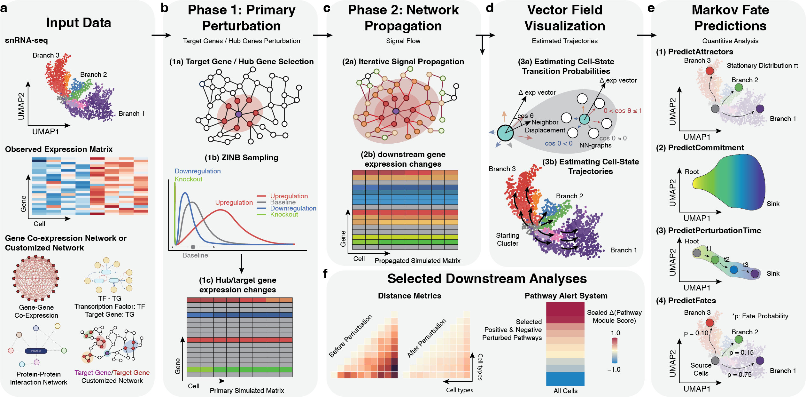

## **`compact`**: co-expression module perturbation analysis 

[](https://github.com/smorabit/compact/tree/main)
[](https://github.com/smorabit/compact/issues)

**`compact`** is a framework for performing CO-expression Module Perturbation Analysis in Cellular Transcriptomes. Building off of our previous method [**`hdWGCNA`**](https://smorabit.github.io/hdWGCNA/), **`compact`** applies direct perturbations to co-expression network hub genes, and uses the network structure to propagate the perturbation signal to other linked genes in the network. This framework is highly flexible to perform knock-in, knock-down, or knock-out perturbations on different networks and sets of genes and in different cell lineages, allowing researchers to explore a wide range of strategies mimicking various experimental conditions and interventions.

**`compact`** is under active development, and is currently an **alpha** version. This means that many features of the final package are missing, and current features are subject to change throughout development. The first major release of **`compact`** will coincide with our forthcoming publication.

To get started, please install the package and then visit the [co-expression module perturbation analysis tutorial](https://smorabit.github.io/compact/articles/basic_tutorial.html).

## Installation

Follow these steps to create an R [conda environment](https://docs.conda.io/en/latest/) for `compact`. Pick **one** track below — mamba or plain conda — then run the shared R steps.

We recommend **mamba**. It is a drop-in replacement for conda's dependency solver, written in C++, so it resolves and installs the many Bioconductor and CRAN dependencies far faster than conda and is much less likely to stall on the environment solve step. If you already have mamba or prefer not to install it, the plain conda track produces the same environment.

<details>
<summary><b>Option A — mamba (recommended)</b></summary>

```bash
# Create a new conda environment (with mamba), and activate it
conda create -n compact -c conda-forge -c bioconda r-base=4.4 mamba
conda activate compact

# Install key packages via conda-forge / bioconda
mamba install -c conda-forge -c bioconda \
  r-seurat \
  bioconductor-singlecellexperiment \
  bioconductor-pcamethods \
  r-hdf5r

# Install additional required packages (dev tools, modeling, plotting)
mamba install -c conda-forge \
  r-devtools r-remotes r-tidyverse r-patchwork r-matrix r-rcpparmadillo \
  r-ggpubr r-lme4 r-nloptr r-rstatix r-car r-pbkrtest r-ggrastr

# Install energy-statistics packages
mamba install -c conda-forge gsl r-gsl r-energy
```

</details>

<details>
<summary><b>Option B — conda</b></summary>

```bash
# Create a new conda environment, and activate it
conda create -n compact -c conda-forge -c bioconda r-base=4.4
conda activate compact

# Install key packages via conda-forge / bioconda
conda install -c conda-forge -c bioconda \
  r-seurat \
  bioconductor-singlecellexperiment \
  bioconductor-pcamethods \
  r-hdf5r

# Install additional required packages (dev tools, modeling, plotting)
conda install -c conda-forge \
  r-devtools r-remotes r-tidyverse r-patchwork r-matrix r-rcpparmadillo \
  r-ggpubr r-lme4 r-nloptr r-rstatix r-car r-pbkrtest r-ggrastr

# Install energy-statistics packages
conda install -c conda-forge gsl r-gsl r-energy
```

</details>

### Then, inside R (both options)

```r
# install BiocManager 
install.packages("BiocManager")

# install hdWGCNA
BiocManager::install(c("WGCNA", "UCell", "GenomicRanges", "GeneOverlap"))
devtools::install_github('smorabit/hdWGCNA', ref='dev')

# finally, install compact
devtools::install_github('smorabit/compact')
```

### Optional — RNA velocity (velocyto.R)

`velocyto.R` is **not** required by `compact` itself — only install it if you plan to run the RNA-velocity tutorials. Install the pre-built conda package rather than compiling from source:

```bash
# mamba
mamba install -c conda-forge -c bioconda r-velocyto.r

# or conda
conda install -c conda-forge -c bioconda r-velocyto.r
```

### Optional — Transcription Factor network analysis

<details>
<summary><b>TF network analysis packages</b></summary>

```bash
# mamba
mamba install -c conda-forge -c bioconda \
  bioconductor-tfbstools bioconductor-rtracklayer \
  bioconductor-genomicranges bioconductor-motifmatchr

# or conda
conda install -c conda-forge -c bioconda \
  bioconductor-tfbstools bioconductor-rtracklayer \
  bioconductor-genomicranges bioconductor-motifmatchr
```

```r
BiocManager::install(c(
  'EnsDb.Hsapiens.v86',
  'BSgenome.Hsapiens.UCSC.hg38',
  'JASPAR2020',
  'JASPAR2024'
)) 
```

</details>


