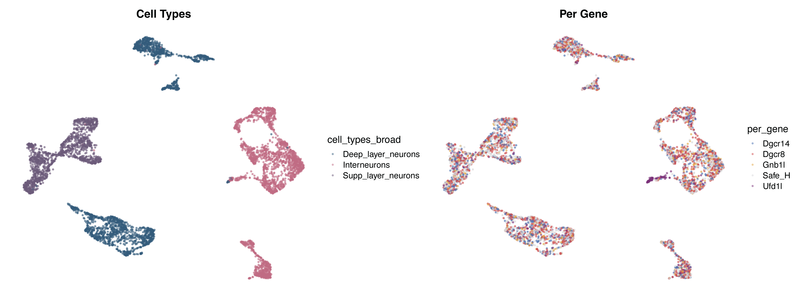
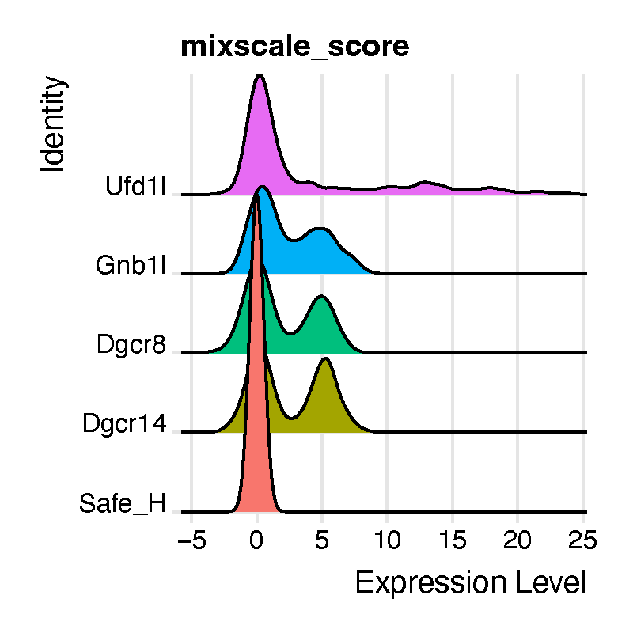
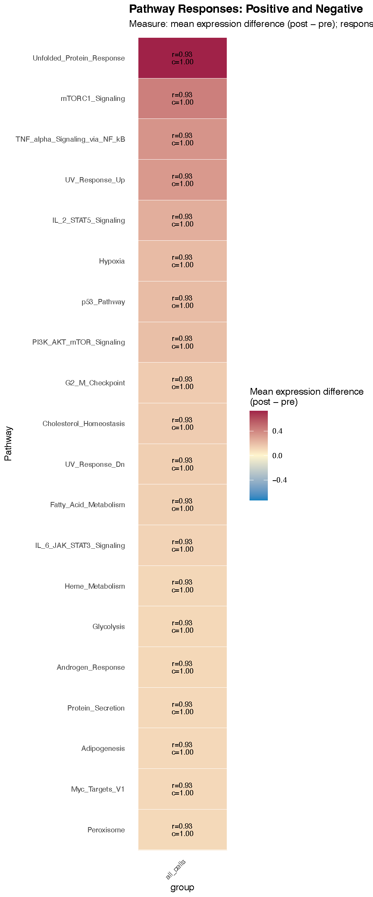

```{r setup, include=FALSE}
knitr::opts_chunk$set(
  echo = TRUE,
  eval = FALSE,
  warning = FALSE,
  message = FALSE
)
```

**compact** can impose module-level changes onto control cells *in silico*
(`ModulePerturbation`), but a perturbed expression matrix on its own does not
tell you *what the cell is now doing differently*. The **Alert System** is the
scoring layer that answers that question: it takes a baseline assay and a
virtually perturbed assay from the same cells, and reports, pathway by pathway,
how strongly and how consistently essential cellular programs respond.

Because every cell contributes a **paired** measurement (its own `pre` and its
own `post`), the Alert System is not a differential-expression test between two
groups of cells. It is a within-cell contrast, which removes the cell-to-cell
variation that usually dominates single-cell pathway scoring and lets us ask a
question that bulk-style summaries cannot: *does the pathway respond in a few
cells very strongly, or in most cells a little?*

## The question this tutorial is built around

Single-cell and single-nucleus profiling characterize only the cells recovered
and retained after sample preparation, sequencing, and quality control. When a
perturbation is lethal or severely destabilizing, the most affected cells are
selectively lost, and what remains is a population that either compensated or
was resilient to begin with. Conventional summaries — cell-type proportions,
differential expression — can look unremarkable precisely *because* the
informative cells are gone.

We work through exactly that situation. For this tutorial we use the in vivo
AAV-Perturb-seq dataset from [Santinha et al.
2023](https://www.nature.com/articles/s41586-023-06570-y), which applied pooled
CRISPR–Cas9 screening with snRNA-seq to the adult mouse prefrontal cortex,
targeting mouse homologues of genes in the 22q11.2 locus. The original study
identified substantial transcriptional responses to all perturbations, but
excluded **`Ufd1l`** from downstream validation because its response was
enriched for a broad disruption of proteostasis rather than a clean
gene-specific phenotype.

`Ufd1l` is a paradox worth chasing. The goal of the gene silencing was to
*eliminate* target expression, yet conventional differential expression reports
`Ufd1l` as significantly **up**regulated in the CRISPR-treated population — and,
as we will see below, most `Ufd1l`-targeted nuclei score near the `Safe_H`
control on a perturbation-strength scale. A misleading transcript-level
increase coupled with an apparent absence of perturbed cell states points to
**survivor bias**: nuclei carrying the strongest disruptions were selectively
depleted, leaving behind a compensating or resilient remainder.

So the analysis proceeds in four steps, and the tutorial follows them in order:

1. **Look at the data.** Confirm the cell types and check whether the
   perturbation produces any gross population shift on the UMAP.
2. **Quantify perturbation strength with Mixscale.** Establish that
   `Ufd1l`-targeted nuclei do *not* separate from control, which is the
   observation that motivates everything after it.
3. **Impose the module change in silico with compact.** Take the module
   alterations observed in the surviving perturbed cells and apply them to
   control cells, so we can ask what those changes would do.
4. **Score the consequences with the Alert System.** Find the stress-associated
   programs that the module change predicts — the signature that was hidden.

---

## Contents

1. [Setup](#setup)
2. [Loading the dataset](#loading-the-dataset)
3. [Visualizing the dataset](#visualizing-the-dataset)
4. [Quantifying perturbation strength with Mixscale](#quantifying-perturbation-strength-with-mixscale)
5. [In-silico module perturbation](#in-silico-module-perturbation)
6. [Loading the pathway database](#loading-the-pathway-database)
7. [Running `AlertSystemScore`](#running-alertsystemscore)
8. [What comes back](#what-comes-back)
9. [The metrics table, column by column](#the-metrics-table-column-by-column)
10. [Choosing a response threshold](#choosing-a-response-threshold)
11. [Statistical calibration](#statistical-calibration)
12. [Visualizing with `AlertHeatmap`](#visualizing-with-alertheatmap)
13. [Combining perturbations](#combining-perturbations)
14. [The UCell channel](#the-ucell-channel)
15. [Saving and reloading](#saving-and-reloading)
16. [Full parameter reference](#full-parameter-reference)
17. [Troubleshooting](#troubleshooting)

---

## Setup

```r
# single-cell analysis package
library(Seurat)

# plotting and data science packages
library(tidyverse)
library(cowplot)
library(patchwork)

# co-expression network analysis packages
library(WGCNA)
library(hdWGCNA)

# using the cowplot theme for ggplot
theme_set(theme_cowplot())

# load compact library
library(compact)

# set random seed for reproducibility
set.seed(12345)

# optionally enable multithreading
# enableWGCNAThreads(nThreads = 8)
```

Set up the output directories up front, so figures and intermediate objects
land in predictable places:

```r
out_dir <- "compact_Updates/Ufd1l/"
if (!dir.exists(out_dir)) dir.create(out_dir, showWarnings = FALSE, recursive = TRUE)

data_out <- paste0(out_dir, "data/")
fig_dir  <- paste0(out_dir, "figures/")

if (!dir.exists(data_out)) dir.create(data_out, showWarnings = FALSE, recursive = TRUE)
if (!dir.exists(fig_dir))  dir.create(fig_dir,  showWarnings = FALSE, recursive = TRUE)

# set the working directory
setwd(data_out)
getwd()
```

> **Why `setwd()`.** hdWGCNA writes the topological overlap matrix to a `TOM/`
> subdirectory relative to the working directory. Setting it explicitly here
> keeps those files with the rest of the analysis output rather than wherever
> the session happened to start.

---

## Loading the dataset

Processed data for [Santinha et al. 2023](https://www.nature.com/articles/s41586-023-06570-y)
are deposited in GEO under accession
[**GSE236519**](https://www.ncbi.nlm.nih.gov/geo/query/acc.cgi?acc=GSE236519).
This tutorial uses the pooled screen driven by the **CBh** promoter
(`GSE236519_pooled_screen_CBh`), subset to neurons and to the `Safe_H` control
plus the four perturbations with the strongest transcriptional phenotypes:
`Dgcr8`, `Dgcr14`, `Gnb1l`, and `Ufd1l`.

The object has already been processed with hdWGCNA to construct a co-expression
network (modules named `CBh-M1` … `CBh-M9`).

```r

# GSE236519_pooled_screen_CBh
seu_CBh_neurons <- subset(GSE236519_pooled_screen_CBh, per_gene %in% c('Safe_H', 'Dgcr8', 'Dgcr14', 'Gnb1l', 'Ufd1l'))
seu_CBh_neurons <- subset(seu_CBh_neurons, cell_types_broad %in% c('Deep_layer_neurons', 'Supp_layer_neurons', 'Interneurons'))

# hdWGCNA processed data
seu_CBh_neurons

```

```
An object of class Seurat
30556 features across 5670 samples within 1 assay
Active assay: RNA (30556 features, 2000 variable features)
 3 layers present: counts, data, scale.data
 2 dimensional reductions calculated: pca, umap
```

```r
table(seu_CBh_neurons$per_gene)
```

```
Dgcr14  Dgcr8  Gnb1l Safe_H  Ufd1l
   870   1666    487   2220    427
```

Note the group sizes: `Ufd1l` has the fewest recovered nuclei of any
perturbation (427), despite being targeted in the same pooled screen. That is
the first quiet hint of selective depletion.

---

## Visualizing the dataset

Before any perturbation modeling, look at the data. We want to know two things:
whether the cell-type annotations are clean, and whether the perturbed nuclei
occupy their own region of the embedding or are intermixed with control.

First, copy the UMAP coordinates into the metadata so we can plot them with
`ggplot2` directly and control the aesthetics precisely:

```r
identical(rownames(seu_CBh_neurons@meta.data),
          rownames(seu_CBh_neurons@reductions$umap@cell.embeddings))
# [1] TRUE

UMAP_df <- seu_CBh_neurons@reductions$umap@cell.embeddings
identical(rownames(seu_CBh_neurons@meta.data), rownames(UMAP_df))
# [1] TRUE

# add the UMAP coordinates to the metadata
for (meta in colnames(UMAP_df)) {
  seu_CBh_neurons@meta.data[[meta]] <-
    UMAP_df[match(rownames(seu_CBh_neurons@meta.data), rownames(UMAP_df)), meta]
}
```

Define consistent color schemes so the same colors carry through every figure in
the project:

```r
library(ggrastr)

color_scheme_per_gene <- list(
  "Safe_H" = "#D9D9D9",  # light gray control
  "Dgcr8"  = "#CC4C4C",  # soft modern red
  "Dgcr14" = "#4C72B0",  # scientific blue
  "Gnb1l"  = "#E2A84A",  # muted gold
  "Ufd1l"  = "#7A3178"   # plum / berry
)

color_scheme_ct <- list(
  "Deep_layer_neurons" = "#355C7D",  # muted deep blue-slate
  "Interneurons"       = "#C06C84",  # soft rosy orchid
  "Supp_layer_neurons" = "#6C5B7B"   # muted lavender-indigo
)
```

```r
# UMAP_1 -> umap_1 ; UMAP_2 -> umap_2
p1 <- seu_CBh_neurons@meta.data %>%
  ggplot(aes(x = umap_1, y = umap_2, color = cell_types_broad)) +
  scale_color_manual(values = color_scheme_ct) +
  rasterise(geom_point(size = 0.5, alpha = 0.5), dpi = 600) +
  ggtitle("Cell Types") +
  umap_theme

p2 <- seu_CBh_neurons@meta.data %>%
  ggplot(aes(x = umap_1, y = umap_2, color = per_gene)) +
  scale_color_manual(values = color_scheme_per_gene) +
  rasterise(geom_point(size = 0.5, alpha = 0.5), dpi = 600) +
  ggtitle("Per Gene") +
  umap_theme

pdf(paste0(fig_dir, 'UMAP_seu_CBh_neurons_celltypes_n_pergene.pdf'),
    height = 6, width = 16)
p1 + p2
dev.off()
```

{width=70%}

The left panel shows the three broad neuronal classes. The right panel is the
one that matters for our question: the perturbed nuclei are distributed across
the same regions as the `Safe_H` control, with no perturbation-specific cluster
and no obvious shift in cell-type composition. A standard reading of this figure
would be "the perturbations did not produce distinct cell states" — and that
reading is exactly what we are going to challenge.

> **Note.** `rasterise()` from **ggrastr** rasterizes only the point layer while
> keeping axes and text as vectors. With thousands of nuclei this keeps the PDF
> small and openable in Illustrator without flattening the labels.

---

## Quantifying perturbation strength with Mixscale

A UMAP tells you about global structure, not about how strongly each individual
nucleus responded. For that we use [**Mixscale**](https://www.nature.com/articles/s41556-025-01622-z), which assigns every cell a
continuous *perturbation score* measuring how far its expression has moved from
the non-targeting control in the direction characteristic of its assigned
perturbation.

> **Where Mixscale comes from.** Mixscale is **not** part of `compact`. It is a
> separate R package from the Satija lab
> ([satijalab.github.io/Mixscale](https://satijalab.github.io/Mixscale),
> source at [github.com/longmanz/Mixscale](https://github.com/longmanz/Mixscale)),
> which extends the **mixscape** workflow introduced in Seurat. The two
> functions used below come from different places:
>
> - `CalcPerturbSig()` is a **Seurat** function (part of the original mixscape
>   workflow). It computes a local perturbation signature by subtracting, from
>   each cell, the average expression of its nearest non-targeting neighbors in
>   PCA space. This removes confounding technical and cell-state variation
>   before scoring.
> - `RunMixscale()` is from the **Mixscale** package. Where mixscape makes a
>   binary perturbed / non-perturbed call, Mixscale returns a **continuous**
>   score, which is what lets us see that a perturbation produced a *graded*
>   response — or, as here, almost none at all.
>
> Install it separately (`remotes::install_github("longmanz/Mixscale")`) and
> cite it alongside `compact`; it is doing independent work in this analysis.

```r
library(ggridges)
library(ggplot2)
library(Mixscale)

# calculate perturbation signatures (Seurat / mixscape)
seu_CBh_neurons <- CalcPerturbSig(
  object         = seu_CBh_neurons,
  assay          = "RNA",
  slot           = "data",
  gd.class       = "per_gene",
  nt.cell.class  = "Safe_H",
  reduction      = "pca",
  ndims          = 20,
  num.neighbors  = 20,
  new.assay.name = "MixScale",
  split.by       = NULL  # metadata column if multiple biological contexts exist
)

# Mixscale: continuous perturbation scores
seu_CBh_neurons <- RunMixscale(
  object          = seu_CBh_neurons,
  assay           = "MixScale",
  slot            = "scale.data",
  labels          = "per_gene",
  nt.class.name   = "Safe_H",
  min.de.genes    = 5,
  logfc.threshold = 0.2,
  de.assay        = "RNA",
  max.de.genes    = 100,
  new.class.name  = "mixscale_score",
  fine.mode       = FALSE,
  verbose         = FALSE,
  split.by        = NULL
)
```

Put the control first so the ridge plot reads left to right as a comparison
against baseline:

```r
gene_order <- c("Safe_H", "Dgcr14", "Dgcr8", "Gnb1l", "Ufd1l")

seu_CBh_neurons$per_gene <- factor(
  seu_CBh_neurons$per_gene,
  levels = gene_order
)
```

```r
# check the distribution of the scores for each perturbation
p <- RidgePlot(
  seu_CBh_neurons,
  features = "mixscale_score",
  group.by = "per_gene"
) + NoLegend()

pdf(paste0(fig_dir, 'RidgePlot_mixscale_score.pdf'), width = 4, height = 4)
p
dev.off()
```

{width=40%}

**This is the observation the rest of the tutorial exists to explain.**
`Dgcr8`, `Gnb1l`, and `Dgcr14` targeting produces distinct populations with
elevated Mixscale scores — a graded, detectable response. Most
`Ufd1l`-targeted nuclei instead sit near the `Safe_H` control, with only a
subset reaching higher scores.

Read together with the conventional differential expression result — `Ufd1l`
appearing *upregulated* in the CRISPR-treated population, the opposite of what
gene silencing should produce — the pattern suggests a complex biological
phenotype rather than a simple failure of the knockout. Nuclei harboring the
strongest `Ufd1l` disruptions were likely selectively depleted, leaving behind a
population that is either compensating for the genetic insult or that was
resilient from the start.

If that is true, the informative cells are not in the dataset and no amount of
re-testing the surviving cells will recover them. What we *can* do is take the
module-level changes that are still visible in the survivors, impose them on
control cells in silico, and ask what those changes would do to essential
cellular programs. That is the next section.

---

## In-silico module perturbation

We apply the perturbation to the **`Safe_H` control cells only**. This is
deliberate: imposing an observed module change onto healthy control cells asks
"what would happen to a normal neuron if this module moved?", which is a cleaner
counterfactual than perturbing cells that are already perturbed (and already
selected).

```r
# make a copy containing only the control cells
seurat_obj <- seu_CBh_neurons %>% subset(per_gene == "Safe_H")

seurat_obj
```

```
An object of class Seurat
30556 features across 2220 samples within 1 assay
Active assay: RNA (30556 features, 2000 variable features)
 3 layers present: counts, data, scale.data
 2 dimensional reductions calculated: pca, umap
```

Inspect the co-expression network that hdWGCNA built:

```r
# optional, if not already present:
# add module eigengenes (MEs) to the metadata
MEs <- GetMEs(seurat_obj)
head(MEs)

modules <- GetModules(seurat_obj)
modules['Ufd1', ]
```

```
     gene_name module     color kME_CBh-M1  kME_grey  kME_CBh-M2  kME_CBh-M3
Ufd1      Ufd1 CBh-M1 turquoise 0.08039656 0.1009212 0.007428157 -0.06576732
      kME_CBh-M4  kME_CBh-M5 kME_CBh-M6 kME_CBh-M7  kME_CBh-M8 kME_CBh-M9
Ufd1 -0.01516595 -0.01295234  0.1026164 -0.0457743 -0.02771402 0.05599821
```

`Ufd1` itself is assigned to module **CBh-M1**, which is one reason that module is the one we downregulate below. The directions we impose, though, come from the data rather than from module membership: differential module eigengene (DME) analysis in hdWGCNA — run upstream of this tutorial and described in the paper, so not repeated here — identified **CBh-M6** as upregulated and **CBh-M1** as downregulated in the surviving `Ufd1l` nuclei relative to the `Safe_H` control. In other words, we are not inventing a perturbation: we are reconstructing the module state the perturbed cells actually ended up in, and asking what that state would do to a healthy neuron.

### Applying the module perturbations

`ModulePerturbation()` moves a module's hub genes in the specified direction and
propagates the change through the cell–cell graph, producing a new assay holding
the perturbed expression matrix.

```r
# apply the up-regulation of module CBh-M6
perturbation_name <- 'M6_up'

seurat_obj <- ModulePerturbation(
  seurat_obj,
  mod               = "CBh-M6",
  perturb_dir       = 1,
  perturbation_name = perturbation_name,
  graph             = 'RNA_nn',
  n_hubs            = 10,
  delta_scale       = 2,
  n_iters           = 10,      # default is 3
  row_normalize     = TRUE,
  use_velocyto      = FALSE,
  n_workers         = 1
)

# apply the down-regulation of module CBh-M1
perturbation_name2 <- 'M1_down'

seurat_obj <- ModulePerturbation(
  seurat_obj,
  mod               = "CBh-M1",
  perturb_dir       = -1,
  perturbation_name = perturbation_name2,
  graph             = 'RNA_nn',
  n_hubs            = 10,
  delta_scale       = 2,
  n_iters           = 10,
  row_normalize     = TRUE,
  use_velocyto      = FALSE,
  n_workers         = 1
)

seurat_obj
```

```
An object of class Seurat
91668 features across 2220 samples within 3 assays
Active assay: RNA (30556 features, 2000 variable features)
 3 layers present: counts, data, scale.data
 2 other assays present: M6_up, M1_down
 2 dimensional reductions calculated: pca, umap
```

The two perturbations are modeled **together** because that is what was observed
in the surviving `Ufd1l` nuclei: a combined module upregulation alongside the
downregulation of CBh-M1 relative to the `Safe_H` control. Scoring them jointly
(see [Combining perturbations](#combining-perturbations)) asks what the *joint*
state does, which is not the same question as scoring each alone.

---

## Loading the pathway database

`LoadAlertSystemPathways()` returns a named list of gene vectors. It resolves
gene sets from three sources, in this order:

1. an explicit `path` you supply,
2. the `inst/extdata` directory shipped with the installed package,
3. an optional download from GitHub (`allow_download = TRUE`).

```r
genetype <- "mouse"   # or "human"

gene_sets_mouse <- LoadAlertSystemPathways(
  genetype = "mouse",
  database = "MSigDBhallmark"
)

gene_sets <- gene_sets_mouse

length(gene_sets)
head(names(gene_sets))
```

Files are looked up by the pattern `<database>_gene_sets_<genetype>.rds`, so a
local copy is found with:

```r
alertdatabasePATH <- "AlertSystem/data/"

gene_sets_mouse <- LoadAlertSystemPathways(
  path     = alertdatabasePATH,   # optional
  genetype = "mouse",
  database = "MSigDBhallmark"
)
```

### Where the hallmark gene sets come from

The bundled `MSigDBhallmark` sets are the MSigDB **hallmark (H)** collection,
cleaned up and stored as an `.rds` of named character vectors. A copy of the
cleaned mouse and human gene lists is archived on Zenodo alongside this project.
If you want to rebuild them from the primary source, or update to a newer MSigDB
release:

- **Human** — the `H: hallmark gene sets` collection, file
  `h.all.v<version>.Hs.symbols.gmt`, from the
  [MSigDB downloads page](https://www.gsea-msigdb.org/gsea/msigdb/collections.jsp).
- **Mouse** — the `MH: hallmark gene sets` collection, file
  `mh.all.v<version>.Mm.symbols.gmt`, from the
  [mouse MSigDB collections page](https://gsea-msigdb.org/gsea/msigdb/mouse/collections.jsp).
  These are native mouse-symbol sets, not naively ortholog-mapped human sets.
- **From R** — the `msigdbr` package (`msigdbr(species = "Mus musculus",
  collection = "H")`) or the WEHI
  [R-format MSigDB](https://bioinf.wehi.edu.au/MSigDB/) distributions give you
  the same content without a manual download.

A `.gmt` file converts to the expected format in two lines:

```r
gmt <- clusterProfiler::read.gmt("mh.all.v2024.1.Mm.symbols.gmt")
gene_sets <- split(gmt$gene, gmt$term)
```

### Custom pathways

`gene_sets` is just a named list, so any pathway collection works — your own
curated signatures, a module gene list, a published signature table:

```r
gene_sets_custom <- list(
  "UPR_core"        = c("Hspa5", "Ddit3", "Atf4", "Xbp1", "Eif2ak3", "Ern1"),
  "OxPhos_complexI" = c("Ndufa1", "Ndufa2", "Ndufb3", "Ndufs1", "Ndufs2"),
  "Glycolysis_core" = c("Hk2", "Pfkl", "Pkm", "Ldha", "Slc2a1")
)
```

Pathways are intersected with the features present in **both** assays, and any
pathway left with fewer than `min_genes` detected genes is dropped. Keep an eye
on the `gene_coverage` column in the output — a hallmark set reduced from 200
genes to 7 is still scored, but it is no longer the pathway you think it is.

---

## Running `AlertSystemScore`

```r
AS_dir <- paste0(fig_dir, "AlertSystem/")
if (!dir.exists(AS_dir)) dir.create(AS_dir, showWarnings = FALSE, recursive = TRUE)

# what biological replicate structure is available?
table(seurat_obj$lane)
```

```r
perturbation_name <- 'M6_up'

alert_v2 <- AlertSystemScore(
  seurat_obj        = seurat_obj,
  gene_sets         = gene_sets,
  perturbation_name = "M6_up",       # the perturbed assay
  baseline_assay    = "RNA",         # the pre state

  # group.by = "cell_types_broad",
  # sample.by = "donor_id",

  score_methods = "expression",      # or c("expression", "ucell")
  summary_fun   = "trimmed_mean",

  expression_response_threshold = 0.01,
  ucell_response_threshold      = 0.005,

  null_unit      = "auto",
  n_permutations = 2000,

  return_details = TRUE
)
```

### What the function does, step by step

1. **Validate.** Checks assays exist, method names are legal, and flags are
   logical. If `"ucell"` is requested but the UCell package is missing, it warns
   and falls back to expression scoring.
2. **Align.** Confirms both assays hold the same cells and features, then puts
   them in the same order.
3. **Filter gene sets.** Keeps pathways with at least `min_genes` detected
   features, recording the original set size so coverage can be reported.
4. **Score, paired.** One response per cell × pathway × method. For the
   expression channel, the per-cell pathway response is the mean over pathway
   genes of the per-gene change:

   $$\Delta_{p,c} \;=\; \frac{1}{|p|}\sum_{g \in p} \bigl(\text{post}_{g,c} - \text{pre}_{g,c}\bigr)$$

   where `pre` and `post` are log-normalized values from the `layer` argument
   (`"data"` by default).
5. **Label direct vs. propagated genes.** Using the counts layers, genes changed
   directly by the perturbation are distinguished from genes that changed only
   through network propagation. These are **annotations only** — they do not
   change any score.
6. **Build the per-cell table.** All paired values in one long data frame.
7. **Summarize per group.** Effect, the three distribution measures, optional
   sign-flip null calibration, leading genes, and the two priority rankings.
   Benjamini–Hochberg FDR is applied separately within each group × method.
8. **Record state** under `seurat_obj@misc[[misc_name]]`, optionally writing RDS
   and CSV to `out_dir`.

---

## What comes back

With `return_details = TRUE` you get a list:

```r
names(alert_v2)
# "seurat"  "per_cell"  "metrics"  "gene_sets"  "params"  "info_file"  "metrics_file"
```

With `return_details = FALSE` (the default) you get the Seurat object back, and
the same content lives in `@misc`:

```r
names(alert_v2$seurat@misc$AlertSystem)
# "schema_version"  "per_cell"  "metrics"  "gene_sets"  "params"
```

### `per_cell` — the paired, cell-level table

```r
head(alert_v2$per_cell)
```

| Column | Meaning |
| --- | --- |
| `cell` | cell barcode |
| `group` | value of `group.by`, or `"all_cells"` |
| `sample` | value of `sample.by`, or `NA` |
| `pathway` | gene set name |
| `score_method` | `"expression"` or `"ucell"` |
| `change_measure` | how the response was computed (e.g. `difference`, `log2_ratio`) |
| `pre_score` | baseline pathway score for this cell |
| `post_score` | perturbed pathway score for this cell |
| `delta` | `post_score - pre_score` (or the log2 ratio) |

This table is the raw material for any custom analysis — the response
distribution for a single pathway, per-cell scatter of two pathways, or mapping
`delta` back onto the UMAP coordinates we added earlier.

### `metrics` — the group-level summary

One row per `group` × `pathway` × `score_method`. This is what `AlertHeatmap()`
reads, and what you should export for the supplement.

```r
alert_v2$metrics %>%
  filter(score_method == "expression") %>%
  arrange(desc(widespread_priority)) %>%
  select(pathway, effect, response_rate, directional_consistency,
         robust_fraction, null_z, empirical_p, fdr) %>%
  head(10)
```

### `params` — provenance

Every argument you passed, plus `compact_version`, `seurat_version`,
`ucell_version` and a `timestamp`. Record this in your methods section; it is
the difference between a reproducible figure and a figure you will have to
regenerate from memory.

```r
alert_v2$params$summary_fun
alert_v2$params$expression_response_threshold
alert_v2$params$compact_version
alert_v2$params$timestamp
```

---

## The metrics table, column by column

This is the heart of the Alert System, so it is worth going through every
column. They fall into six families.

### 1. Identity and size

| Column | Definition |
| --- | --- |
| `group` | the `group.by` level (or `"all_cells"`) |
| `pathway` | gene set name |
| `score_method` | `"expression"` or `"ucell"` |
| `change_measure` | the response transformation used |
| `n_cells` | cells contributing to this row |
| `n_samples` | distinct `sample.by` values, when supplied |

### 2. The effect and its distribution

| Column | Definition |
| --- | --- |
| `effect` | the headline group-level response, computed with `summary_fun` |
| `mean_delta` | arithmetic mean of per-cell `delta` |
| `median_delta` | median of per-cell `delta` |
| `trimmed_mean_delta` | mean after removing `trim` from each tail |
| `q10_delta`, `q90_delta` | 10th and 90th percentiles of per-cell `delta` |

`effect` is one of `mean_delta` / `median_delta` / `trimmed_mean_delta`
depending on `summary_fun`; the other three are always reported so you can see
how much the choice matters. **The default, `"trimmed_mean"`, is the right
default**: single-cell pathway deltas have heavy tails, and a plain mean can be
dragged by a handful of cells. If `mean_delta` and `trimmed_mean_delta` disagree
sharply for a pathway, that pathway's response is concentrated in a small number
of cells — which is exactly what `focal_priority` below is designed to find.

### 3. The three distribution measures

These are the measures described in the methods, and they are the reason the
Alert System says more than a fold-change.

| Column | Definition |
| --- | --- |
| `response_threshold` | the threshold in force for this channel |
| `response_rate` | fraction of **all** cells with \|delta\| ≥ threshold |
| `directional_consistency` | among **responding** cells, fraction whose sign matches `sign(effect)` |
| `robust_fraction` | fraction of **all** cells that both respond **and** match `sign(effect)` |
| `opposite_fraction` | fraction of **all** cells that respond with the **opposite** sign |
| `tie_fraction` | fraction of responding cells with no resolvable direction |
| `concordance_all` | direction agreement computed over all cells, not only responders |

`directional_consistency` is `NA` when `effect` is exactly zero or no cell
responds; `robust_fraction` and `opposite_fraction` are `0` under the same
conditions.

Read them as a triple:

- **High `response_rate`, high `directional_consistency`** → a coherent,
  population-wide program shift. This is the signature you want to report.
- **Low `response_rate`, high `directional_consistency`** → a *focal* response:
  a minority of cells move, but they all move the same way. Easy to miss in a
  group mean, and often the most interesting biology in a vulnerability screen.
- **High `response_rate`, low `directional_consistency`** → cells are responding
  but disagreeing. Usually heterogeneity you have not modeled yet (a cell state
  or lineage splitting the response); try `group.by`.
- **High `opposite_fraction`** → an explicit warning that the group-level sign
  is averaging over two populations moving in opposite directions. Do not report
  the group effect for such a pathway without splitting the group.

### 4. Calibration

| Column | Definition |
| --- | --- |
| `calibration_effect` | the statistic the null was built around |
| `null_center` | center of the sign-flip null distribution |
| `null_scale` | spread of the sign-flip null distribution |
| `null_z` | standardized effect, `(calibration_effect − null_center) / null_scale` |
| `empirical_p` | two-sided empirical p-value from `n_permutations` sign flips |
| `fdr` | Benjamini–Hochberg FDR, computed **within each group × score_method** |

The null is a **two-sided sign-flip** permutation: the signs of the paired
responses are randomly flipped, which is the correct null for a paired design
("the perturbation moved this pathway in no particular direction"). By default
the flips are applied at the **sample** level — see
[Statistical calibration](#statistical-calibration) for why that matters.

### 5. Gene coverage and leading genes

| Column | Definition |
| --- | --- |
| `genes_in_set` | size of the original gene set |
| `genes_used` | genes retained after intersecting with both assays |
| `gene_coverage` | `genes_used / genes_in_set` |
| `n_direct_overlap` | pathway genes changed directly by the perturbation |
| `n_propagated_overlap` | pathway genes changed only through propagation |
| `gene_direction_fraction` | fraction of pathway genes moving with the effect |
| `leading_genes` | top `leading_n` genes by mean gene-level change |

`n_direct_overlap` is the circularity check. If a pathway's response is driven
mostly by genes you perturbed directly — the module's own hub genes — then the
Alert System is reporting your input back to you. A pathway with a high
`n_propagated_overlap` and a low `n_direct_overlap` is a genuinely *downstream*
consequence of the module change, and that is the claim worth making.

```r
# pathways whose response is mostly propagated, not directly imposed
alert_v2$metrics %>%
  filter(score_method == "expression", fdr <= 0.05) %>%
  mutate(propagated_share = n_propagated_overlap /
           pmax(n_direct_overlap + n_propagated_overlap, 1)) %>%
  filter(propagated_share > 0.8) %>%
  arrange(desc(widespread_priority)) %>%
  select(pathway, effect, propagated_share, n_direct_overlap,
         n_propagated_overlap, leading_genes)
```

### 6. The two priority scores

These exist because no single number ranks pathways well. They combine strength,
breadth and coherence in two different ways.

**`widespread_priority` — find programs that moved across the population.**

```
standardized_strength = |null_z|                       if calibration available
                      = |effect| / threshold           if threshold > 0
                      = |effect|                       otherwise

consistency_signal    = max(0, 2 * directional_consistency - 1)
                      = 0                              if not finite

widespread_priority   = standardized_strength * sqrt(response_rate) * consistency_signal
```

The `2c − 1` term is the key design choice: a pathway at 50% directional
consistency is a coin flip and scores **zero**, no matter how large its effect.
The `sqrt(response_rate)` term rewards breadth with diminishing returns, so a
pathway responding in 80% of cells is not ranked four times above one responding
in 20%.

**`focal_priority` — find programs that moved hard in a minority of cells.**

```
focal_tail      = max(0, 90th percentile of (sign(effect) * delta))
                = 0                                     if effect == 0

focal_priority  = (focal_tail / threshold) * sqrt(robust_fraction)   if threshold > 0
                = focal_tail * sqrt(robust_fraction)                 otherwise
```

Here the magnitude comes from the **tail** of the direction-adjusted response
rather than its center, so a pathway that barely moves on average but moves
dramatically in the top decile of cells rises to the top. This is the ranking to
use when you are hunting for vulnerable subpopulations — the cells that would
have been lost to selection in a real experiment, which is precisely the
population we suspect is missing from the `Ufd1l` data.

```r
# compare the two rankings side by side
bind_rows(
  alert_v2$metrics %>% filter(score_method == "expression") %>%
    arrange(desc(widespread_priority)) %>% head(10) %>%
    mutate(ranking = "widespread"),
  alert_v2$metrics %>% filter(score_method == "expression") %>%
    arrange(desc(focal_priority)) %>% head(10) %>%
    mutate(ranking = "focal")
) %>%
  select(ranking, pathway, effect, response_rate, robust_fraction,
         widespread_priority, focal_priority)
```

Pathways appearing in the focal list but not the widespread list are the
candidates for the hidden-vulnerability narrative: real, coherent, and invisible
to a group mean.

---

## Choosing a response threshold

`expression_response_threshold` (default `0.01`) and
`ucell_response_threshold` (default `0.005` for differences, `0.1` for log2
ratios) define what counts as "a cell responded". Everything in family 3 above,
and both priority scores, depends on it — so it should be a deliberate choice,
not an inherited default.

A practical way to set it is to look at the response distribution itself:

```r
alert_v2$per_cell %>%
  filter(score_method == "expression") %>%
  ggplot(aes(x = abs(delta))) +
  geom_density() +
  geom_vline(xintercept = 0.01, linetype = "dashed", color = "#CC4C4C") +
  scale_x_log10() +
  labs(x = "|pathway response| (log10)", y = "density")
```

You are looking for a value that sits above the bulk of the near-zero mass but
below the shoulder of real responses. A useful sanity check is to rescore with a
modestly stricter threshold:

```r
alert_strict <- AlertSystemScore(
  seurat_obj, gene_sets, perturbation_name = "M6_up",
  score_methods = "expression",
  expression_response_threshold = 0.03,
  null_unit = "auto", n_permutations = 2000,
  misc_name = "AlertSystem_strict",
  return_details = TRUE
)
```

If a pathway's rank collapses under a 3× stricter threshold, its `response_rate`
was being carried by cells sitting just above the cutoff.

> **A note on scale.** The threshold is on the same scale as `delta`, which for
> the expression channel is a mean log-normalized difference averaged over
> pathway genes. That number is small by construction — averaging over 100+
> genes shrinks it — so `0.01` is a meaningful amount of movement, not a
> rounding error. UCell scores are bounded rank statistics on a different scale
> entirely, which is why they get their own threshold.

---

## Statistical calibration

This section matters more than any other for how you write up the result.

### Cells are not replicates

The Alert System happily scores thousands of cells, and the per-cell
distribution measures (`response_rate`, `directional_consistency`,
`robust_fraction`) are **descriptive** statistics of that distribution — they
are the point of the method and they are valid as described.

But *p*-values are a different matter. Cells from one animal are not independent
replicates of the biological condition. The source code is explicit about this:
cell-level null calibration is labeled descriptive, and inferential calibration
is intended to run at the sample level.

```r
null_unit = "auto"      # samples when sample.by is supplied; otherwise no calibration
null_unit = "sample"    # force sample-level sign flips (inferential)
null_unit = "cell"      # force cell-level sign flips (DESCRIPTIVE ONLY)
null_unit = "none"      # skip calibration entirely
```

With `null_unit = "auto"` and no `sample.by`, calibration is **disabled** — this
is a deliberate guardrail, not a bug. `null_z`, `empirical_p` and `fdr` will be
`NA`, and `widespread_priority` will fall back to `|effect| / threshold` for its
strength term.

**Recommendation:** if your design has replicates, pass them. We checked
`table(seurat_obj$lane)` earlier for exactly this reason:

```r
alert_calibrated <- AlertSystemScore(
  seurat_obj        = seurat_obj,
  gene_sets         = gene_sets,
  perturbation_name = "M6_up",
  baseline_assay    = "RNA",

  group.by  = "cell_types_broad",   # score within each neuronal class
  sample.by = "lane",               # or "donor_id", "animal", "batch"

  score_methods = "expression",
  summary_fun   = "trimmed_mean",
  trim          = 0.1,

  expression_response_threshold = 0.01,
  null_unit      = "sample",
  n_permutations = 2000,
  return_details = TRUE
)
```

If you genuinely have one sample — a pooled screen with no replication — run
with `null_unit = "none"`, rank by `widespread_priority` and `focal_priority`,
and describe the result as a prioritization rather than a test. That is an
honest and perfectly publishable framing for pilot data, and it fits the way
this analysis is used: to flag signatures worth following up and to refine
experimental design before committing resources to a larger experiment.

### `group.by`

Supplying `group.by` scores each level separately, with its own effect, its own
null, and its own FDR correction. Use it whenever the response plausibly differs
between cell types — which, for a module perturbation across deep-layer,
superficial-layer and interneuron populations, is likely. Watch
`sample_consistency`: it reports the fraction of per-sample effects whose sign
matches the group effect, and a value near 0.5 means your group-level effect is
not reproducible across samples regardless of what the p-value says.

---

## Visualizing with `AlertHeatmap`

```r
perturbation_name <- 'M6_up'

p_widespread <- AlertHeatmap(
  alert_v2$seurat,
  score_method     = "expression",
  top_n            = 20,
  side             = "both",
  select_by        = "widespread_priority",
  fill_by          = "effect",
  show_annotations = TRUE,
  show_fdr         = TRUE
)

pdf(paste0(AS_dir, 'AlertHeatmap_', perturbation_name, '.pdf'), width = 5, height = 12)
p_widespread
dev.off()
```

{width=50%}

`AlertHeatmap()` reads `seurat_obj@misc[[misc_name]]$metrics` directly — you
pass the Seurat object, not the metrics table.

### Reading the plot

- **Rows** are pathways, selected by `select_by` and ordered by `reorder_by`.
- **Columns** are the levels of `group.by` (a single `all_cells` column if you
  did not group).
- **Tile fill** is `effect` (native response units) or `null_z` (standardized).
- **In-tile annotations**, when `show_annotations = TRUE`, are `r` =
  `response_rate` and `c` = `directional_consistency`. These are what make the
  heatmap more informative than a standard pathway heatmap: a deeply colored
  tile with `r` = 0.08 is a focal response, not a population-wide one.
- **Asterisks**, when `show_fdr = TRUE`, mark `fdr <= fdr_cutoff` (default
  `0.05`). With no `sample.by`, there will be no asterisks — see
  [Statistical calibration](#statistical-calibration).

### Selection, scaling and the focal view

`top_n` is applied **separately to each requested side**, so `side = "both"` with
`top_n = 20` gives up to 40 rows — 20 up, 20 down.

Two arguments are worth knowing about. `scale_mode = "unit"` divides by a robust
magnitude (the `unit_q` quantile of absolute displayed values, default `0.9`) and
clips to `[-1, 1]`; use it when a single dominant pathway is flattening the color
scale. We use it for the combined perturbation below. For a figure panel where
several perturbations must share one scale, fix `fill_limits` explicitly instead:

```r
AlertHeatmap(alert_v2$seurat, fill_limits = c(-0.05, 0.05), ...)
```

Swapping `select_by` switches between the two narratives:

```r
# the same data ranked for minority-but-strong responses
AlertHeatmap(
  alert_v2$seurat,
  score_method     = "expression",
  top_n            = 15,
  side             = "both",
  select_by        = "focal_priority",
  fill_by          = "effect",
  show_annotations = TRUE,
  show_fdr         = TRUE
)
```

Pathways that appear under `focal_priority` but not `widespread_priority` are
your hidden-vulnerability candidates.

---

## Combining perturbations

Real module changes rarely happen one at a time. The surviving `Ufd1l` nuclei
show a combined module upregulation *and* a downregulation of CBh-M1 relative to
control, so scoring each perturbation separately answers a different question
than scoring the joint state. `CombinePerturbAssays()` builds that joint assay.

```r
# clear any previous Alert System state so results are not silently mixed
seurat_obj@misc$AlertSystem <- NULL
"AlertSystem" %in% names(seurat_obj@misc)
# [1] FALSE

seurat_obj <- CombinePerturbAssays(
  seurat_obj,
  perturb_assays = c("M6_up", "M1_down"),
  baseline_assay = "RNA",
  new_assay      = "M6up_M1down"
)
```

### What combining actually does

Perturbation assays are mixed-layer objects: **direct targets** are changed in
the `counts` layer, while **secondary genes** are changed by network propagation
in the log-normalized `data` layer. Naively adding two such assays would
double-count. `CombinePerturbAssays()` instead:

1. adds the count-space deltas from each assay to the baseline counts,
2. log-normalizes the result using the **baseline library sizes** (so the
   normalization is not itself perturbed), and
3. adds each assay's data-space delta **only for genes not directly changed in
   that assay**.

Step 3 is what keeps secondary effects intact when a gene is a direct target in
one perturbation and a propagated gene in the other. Provenance metadata is
written to the new assay's `misc` slot.

Useful arguments:

| Argument | Default | Why you'd change it |
| --- | --- | --- |
| `new_assay` | `"<assays>_combined"` | name it for the figure |
| `scale.factor` | `1e4` | match a non-standard normalization |
| `direct_tolerance` | `0` | a gene is "direct" if any cell's count change exceeds this |
| `check_provenance` | `TRUE` | verify each input was built from `baseline_assay` |
| `require_provenance` | `FALSE` | set `TRUE` to hard-fail on unstamped assays |
| `floor_counts` / `floor_data` | `TRUE` | zero out negatives; `FALSE` errors instead |
| `overwrite` | `FALSE` | replace an existing assay of the same name |

If `check_provenance = TRUE` and `strict_provenance_check = TRUE` (both
defaults), a stamp that conflicts with `baseline_assay` or lacks the counts
layer stops the function. Set `strict_provenance_check = FALSE` to downgrade
that to a warning — but understand why the stamp disagrees before you do.

### Score the combined assay

```r
alert_v2_combined <- AlertSystemScore(
  seurat_obj        = seurat_obj,
  gene_sets         = gene_sets,
  perturbation_name = "M6up_M1down",
  baseline_assay    = "RNA",

  # group.by = "cell_types_broad",
  # sample.by = "lane",

  score_methods = "expression",
  summary_fun   = "trimmed_mean",
  trim          = 0.1,

  expression_response_threshold = 0.01,
  ucell_response_threshold      = 0.005,

  null_unit      = "auto",
  n_permutations = 2000,

  return_details = TRUE
)

p_widespread2 <- AlertHeatmap(
  alert_v2_combined$seurat,
  score_method     = "expression",
  top_n            = 15,
  scale_mode       = "unit",
  unit_q           = 0.9,
  side             = "both",
  select_by        = "widespread_priority",
  fill_by          = "effect",
  show_annotations = TRUE,
  show_fdr         = TRUE
)

pdf(paste0(AS_dir, 'AlertHeatmap_M6up_M1down_v2_top15.pdf'), width = 5, height = 8)
p_widespread2
dev.off()
```

{width=50%}

This is the result the whole workflow was building toward. The joint module
change predicts **increased** expression of genes associated with the unfolded
protein response, hypoxia, inflammatory and glycolytic programs, accompanied by
**decreased** expression of the oxidative phosphorylation program.

That is a coordinated stress signature, and it connects back to the original
observation in two ways. The predicted unfolded protein response is consistent
with the proteostasis-related enrichment reported for `Ufd1l` in the original
study — which is the reason it was set aside. The accompanying hypoxia- and
metabolism-associated changes suggest something broader: a disruption of
cellular homeostasis of the kind that would plausibly make a neuron vulnerable,
and plausibly cause the most affected nuclei to be lost before sequencing.

### Is the combination more than the sum of its parts?

Scoring all three assays lets you ask whether the joint perturbation produces a
response the single perturbations do not:

```r
score_one <- function(assay) {
  AlertSystemScore(
    seurat_obj, gene_sets, perturbation_name = assay,
    baseline_assay = "RNA", score_methods = "expression",
    expression_response_threshold = 0.01,
    null_unit = "none", misc_name = paste0("AS_", assay),
    return_details = TRUE, verbose = FALSE
  )$metrics %>%
    filter(score_method == "expression") %>%
    select(pathway, effect, response_rate) %>%
    rename_with(~paste0(.x, "_", assay), -pathway)
}

comparison <- reduce(
  map(c("M6_up", "M1_down", "M6up_M1down"), score_one),
  full_join, by = "pathway"
) %>%
  mutate(interaction = effect_M6up_M1down - (effect_M6_up + effect_M1_down)) %>%
  arrange(desc(abs(interaction)))

head(comparison, 15)
```

A large `interaction` term flags pathways where the two module changes are not
additive — the joint state does something neither module does alone. Treat this
as hypothesis generation rather than a formal interaction test.

> **Important.** Always clear or rename the Alert System state between runs.
> `misc_name` defaults to `"AlertSystem"` for every call, so a second
> `AlertSystemScore()` on the same object will overwrite the first, and an
> `AlertHeatmap()` call will silently plot whichever ran last. Either set
> `seurat_obj@misc$AlertSystem <- NULL` between runs, or give each run its own
> `misc_name`.
>
> Note also that `perturbation_name` must name an **existing assay**. If you
> named the combined assay `"M6up_M1down"`, that exact string is what
> `AlertSystemScore()` needs — a suffixed variant will not resolve.

---

## The UCell channel

The expression channel averages log-normalized differences, which makes it
sensitive to the absolute magnitude of expression change and to highly expressed
pathway genes. [UCell](https://github.com/carmonalab/UCell) instead computes a
**rank-based** signature score per cell, which is robust to depth and to a few
dominant genes. Running both is a strong robustness check: a pathway that tops
both rankings is not an artifact of the scoring scale.

```r
alert_v2_combined2 <- AlertSystemScore(
  seurat_obj        = seurat_obj,
  gene_sets         = gene_sets,
  perturbation_name = "M6up_M1down",
  baseline_assay    = "RNA",

  # group.by = "cell_types_broad",
  # sample.by = "lane",

  score_methods = "ucell",
  ucell_change  = "log2_ratio",
  trim          = 0.1,

  expression_response_threshold = 0.01,
  ucell_response_threshold      = 0.005,

  null_unit      = "auto",
  n_permutations = 2000,

  return_details = TRUE
)

p_widespread4 <- AlertHeatmap(
  alert_v2_combined2$seurat,
  score_method     = "ucell",
  top_n            = 50,
  scale_mode       = "unit",
  unit_q           = 0.9,
  side             = "both",
  select_by        = "widespread_priority",
  fill_by          = "effect",
  show_annotations = TRUE,
  show_fdr         = TRUE
)

```

### `difference` vs. `log2_ratio`

| `ucell_change` | Response | Default threshold | When to use |
| --- | --- | --- | --- |
| `"difference"` | `post - pre` | `0.005` | the default; symmetric, interpretable in UCell units |
| `"log2_ratio"` | `log2((post + pc) / (pre + pc))` | `0.1` | when baseline scores vary widely across cells and you want *relative* change |

The pseudocount `ucell_pseudocount` (default `1e-4`) stabilizes the ratio for
cells with near-zero baseline scores, and is used **only** for `"log2_ratio"`.

**Set the threshold to match the channel.** The call above passes
`ucell_change = "log2_ratio"` together with `ucell_response_threshold = 0.005`,
which is a *difference*-scale value. On the log2-ratio scale that threshold is
very permissive, so nearly every cell will count as responding and
`response_rate` becomes uninformative. Leaving `ucell_response_threshold = NULL`
lets the function pick the right default (`0.1`) for the transformation you
chose — the safest option:

```r
  ucell_change             = "log2_ratio",
  ucell_response_threshold = NULL,   # -> 0.1, the log2-ratio default
```

Scoring both channels in one call keeps them in a single metrics table:

```r
alert_both <- AlertSystemScore(
  seurat_obj, gene_sets, perturbation_name = "M6up_M1down",
  score_methods = c("expression", "ucell"),
  ucell_change = "difference",
  ucell_response_threshold = NULL,
  expression_response_threshold = 0.01,
  null_unit = "auto", n_permutations = 2000,
  return_details = TRUE
)

# pathways prioritized by both channels
alert_both$metrics %>%
  select(pathway, score_method, widespread_priority) %>%
  pivot_wider(names_from = score_method, values_from = widespread_priority) %>%
  arrange(desc(pmin(expression, ucell))) %>%
  head(15)
```

FDR is computed within each group **and** each score method, so the two channels
are corrected independently — as they should be, since they are two views of the
same data rather than two additional tests.

---

## Saving and reloading

Scoring with 2000 permutations over a full hallmark collection is not free.
Persist the state so figures can be regenerated without rescoring.

### Automatic export

```r
alert_v2 <- AlertSystemScore(
  seurat_obj, gene_sets, perturbation_name = "M6_up",
  score_methods     = "expression",
  out_dir           = AS_dir,
  output_prefix     = "Ufd1l_M6up",     # defaults to a sanitized perturbation name
  overwrite_outputs = FALSE,
  return_details    = TRUE
)

alert_v2$info_file      # RDS of the complete state
alert_v2$metrics_file   # CSV of the metrics table
```

`overwrite_outputs = FALSE` refuses to clobber existing files — keep it that way
until you are sure you want to replace a figure's source data.

### Manual save and load

```r
SaveAlertSystem(
  seurat_obj,
  file      = paste0(AS_dir, "AlertSystem_M6_up.rds"),
  misc_name = "AlertSystem",
  overwrite = FALSE
)

# later, or in a fresh session
seurat_obj <- LoadAlertSystem(
  seurat_obj,
  file              = paste0(AS_dir, "AlertSystem_M6_up.rds"),
  misc_name         = "AlertSystem",
  overwrite         = TRUE,
  require_gene_sets = FALSE,
  verbose           = TRUE
)

# AlertHeatmap(seurat_obj, score_method = "expression", top_n = 20)
```

`SaveAlertSystem()` refuses to overwrite unless `overwrite = TRUE`, creates the
parent directory if needed, and returns the normalized path invisibly.
`LoadAlertSystem()` validates the state (`per_cell`, `metrics`, `params`, and
`gene_sets` when `require_gene_sets = TRUE`) before attaching it. It does
**not** add score columns to `meta.data` — the state lives in `@misc` only.

---

## Full parameter reference

<details class="alert alert-info">
<summary><strong>Show the full parameter reference</strong> — every argument and default for <code>AlertSystemScore()</code>, <code>AlertHeatmap()</code>, <code>CombinePerturbAssays()</code>, and the pathway/state helpers</summary>

### `AlertSystemScore()`

```r
AlertSystemScore(
  seurat_obj,
  gene_sets,
  perturbation_name,
  baseline_assay = "RNA",
  group.by = NULL,
  sample.by = NULL,
  layer = "data",
  min_genes = 5L,
  score_methods = c("expression", "ucell"),
  ucell_change = c("difference", "log2_ratio"),
  ucell_pseudocount = 1e-4,
  summary_fun = c("trimmed_mean", "median", "mean"),
  trim = 0.1,
  expression_response_threshold = 0.01,
  ucell_response_threshold = NULL,
  null_unit = c("auto", "sample", "cell", "none"),
  n_permutations = 1000L,
  seed = 1L,
  leading_n = 5L,
  gene_change_tolerance = 1e-8,
  misc_name = "AlertSystem",
  out_dir = NULL,
  output_prefix = NULL,
  overwrite_outputs = FALSE,
  return_details = FALSE,
  verbose = TRUE
)
```

| Argument | Default | Notes |
| --- | --- | --- |
| `seurat_obj` | — | must contain baseline **and** perturbation assays |
| `gene_sets` | — | named list of gene vectors |
| `perturbation_name` | — | name of the perturbed assay |
| `baseline_assay` | `"RNA"` | the `pre` state |
| `group.by` | `NULL` | metadata column; `NULL` → one `"all_cells"` group |
| `sample.by` | `NULL` | biological replicate column; **strongly recommended** |
| `layer` | `"data"` | log-normalized layer used by expression scoring |
| `min_genes` | `5L` | pathways below this (after intersection) are dropped |
| `score_methods` | `c("expression","ucell")` | pass one or both |
| `ucell_change` | `"difference"` | or `"log2_ratio"` |
| `ucell_pseudocount` | `1e-4` | used only for `"log2_ratio"` |
| `summary_fun` | `"trimmed_mean"` | also `"median"`, `"mean"` |
| `trim` | `0.1` | tail fraction removed per side |
| `expression_response_threshold` | `0.01` | defines "responded" for the expression channel |
| `ucell_response_threshold` | `NULL` | `NULL` → `0.005` (difference) or `0.1` (log2 ratio) |
| `null_unit` | `"auto"` | `"auto"` uses samples if `sample.by` given, else disables |
| `n_permutations` | `1000L` | 2000+ for stable empirical p-values |
| `seed` | `1L` | seeds the null and temporary UCell column names |
| `leading_n` | `5L` | leading genes recorded per pathway × group |
| `gene_change_tolerance` | `1e-8` | direct vs. propagated classification tolerance |
| `misc_name` | `"AlertSystem"` | **change it per run to avoid overwriting** |
| `out_dir` | `NULL` | when set, writes RDS + CSV |
| `output_prefix` | `NULL` | defaults to a sanitized perturbation name |
| `overwrite_outputs` | `FALSE` | guard against clobbering figure source data |
| `return_details` | `FALSE` | `TRUE` returns the full list |
| `verbose` | `TRUE` | progress messages |

### `AlertHeatmap()`

```r
AlertHeatmap(
  seurat_obj,
  misc_name = "AlertSystem",
  score_method = c("expression", "ucell"),
  top_n = 5L,
  side = c("both", "positive", "negative"),
  select_by = c("widespread_priority", "focal_priority", "abs_effect",
                "null_z", "robust_fraction", "response_rate"),
  fill_by = c("effect", "null_z"),
  reorder_by = c("effect", "select"),
  scale_mode = c("none", "unit"),
  unit_q = 0.9,
  show_annotations = TRUE,
  show_fdr = TRUE,
  fdr_cutoff = 0.05,
  fill_limits = NULL
)
```

### `CombinePerturbAssays()`

```r
CombinePerturbAssays(
  seurat_obj,
  perturb_assays,
  baseline_assay = "RNA",
  new_assay = paste0(paste(perturb_assays, collapse = "_"), "_combined"),
  scale.factor = 1e4,
  direct_tolerance = 0,
  check_provenance = TRUE,
  require_provenance = FALSE,
  strict_provenance_check = TRUE,
  floor_counts = TRUE,
  floor_data = TRUE,
  allow_dense = FALSE,
  overwrite = FALSE,
  verbose = TRUE
)
```

### `LoadAlertSystemPathways()` / `SaveAlertSystem()` / `LoadAlertSystem()`

```r
LoadAlertSystemPathways(
  path = NULL,
  genetype = c("mouse", "human"),
  database = "MSigDBhallmark",
  package = "compact",
  allow_download = TRUE,
  github_base = <package default>,
  verbose = TRUE
)

SaveAlertSystem(seurat_obj, file, misc_name = "AlertSystem", overwrite = FALSE)

LoadAlertSystem(seurat_obj, file, misc_name = "AlertSystem",
                overwrite = TRUE, require_gene_sets = FALSE, verbose = TRUE)
```

Resolution order for `LoadAlertSystemPathways()` is `path` → the package's
`inst/extdata` → GitHub download (`allow_download = TRUE`), looking for
`<database>_gene_sets_<genetype>.rds`.

</details>

---

## Troubleshooting

<details class="alert alert-warning">
<summary><strong>Show the troubleshooting table</strong> — common symptoms, their causes, and what to change</summary>

| Symptom | Likely cause | Fix |
| --- | --- | --- |
| `null_z`, `empirical_p`, `fdr` all `NA` | `null_unit = "auto"` with no `sample.by` | supply `sample.by`, or set `null_unit = "sample"` / `"none"` deliberately |
| No asterisks on the heatmap | same as above | see above |
| Heatmap shows the wrong perturbation | `misc_name` collision between runs | set a distinct `misc_name` per run, or `NULL` the old state |
| `perturbation_name` not found | name does not match an existing assay | check `Assays(seurat_obj)` |
| Many pathways dropped | `min_genes` vs. sparse detection | check `gene_coverage`; confirm the gene sets' species matches the object |
| UCell results look degenerate | threshold on the wrong scale | leave `ucell_response_threshold = NULL` |
| `response_rate` near 1.0 for everything | threshold too low | inspect the `abs(delta)` density and raise it |
| `directional_consistency` near 0.5 | unmodeled heterogeneity | add `group.by`; check `opposite_fraction` |
| Top pathways are all module hub genes | circularity | filter on `n_propagated_overlap` vs. `n_direct_overlap` |
| `CombinePerturbAssays` errors on provenance | assays built from a different baseline | confirm the baseline, or set `strict_provenance_check = FALSE` knowingly |

</details>

<div style="display: none;">

<!-- Hidden from the rendered page. Kept in the source for reference; delete
     this wrapper div to make the section visible again. -->

## Reporting checklist

When writing up an Alert System result, state:

1. the pathway database and version (`MSigDBhallmark`, species, MSigDB release);
2. `min_genes` and the observed `gene_coverage` range;
3. the scoring channel(s) and, for UCell, the `ucell_change` transformation;
4. `summary_fun` and `trim`;
5. the response threshold for each channel;
6. `null_unit`, `sample.by`, and `n_permutations` — or an explicit statement
   that the analysis is a prioritization rather than a test;
7. whether ranking used `widespread_priority` or `focal_priority`;
8. the direct/propagated split for the pathways you highlight;
9. the separate provenance of upstream tools — **Mixscale** is its own package
   and should be cited independently of `compact`.

```r
sessionInfo()
```

</div>
