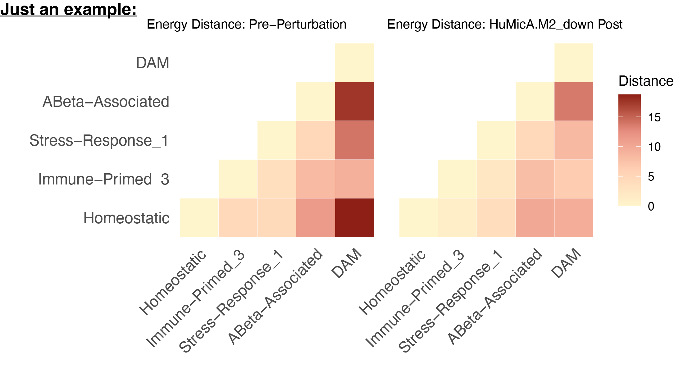
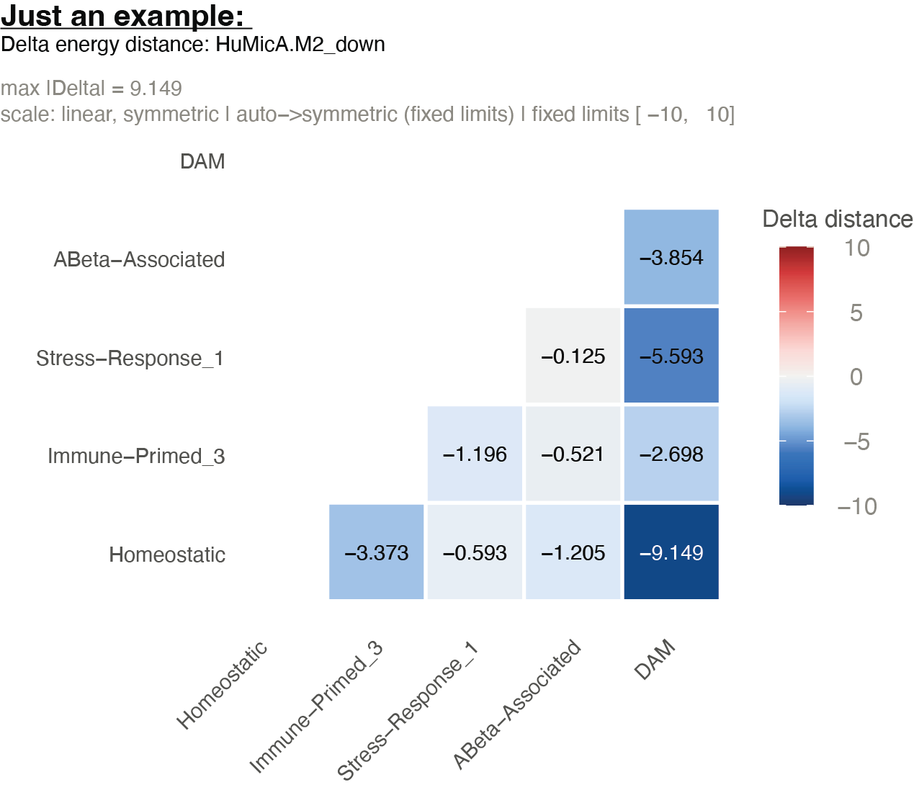

```{r setup, include=FALSE}
knitr::opts_chunk$set(
  eval = FALSE,
  collapse   = TRUE,
  comment    = "#>",
  message    = FALSE,
  warning    = FALSE,
  fig.width  = 8,
  fig.height = 4,
  eval       = FALSE
)
# force eval=FALSE on every chunk regardless of chunk-level overrides
knitr::opts_hooks$set(eval = function(options) {
  if (isTRUE(options$force_eval)) return(options)
  options$eval <- FALSE
  options
})
```

Compiled: `r Sys.Date()`

Source: `vignettes/distance_assessment.Rmd`

# Introduction

The perturbation vignettes end where this one begins. Once
`ModulePerturbation()` has produced a perturbed assay, the natural next
question is not *what changed in the genes* but **what changed in the
relationships between cell states**: did the perturbation pull two
populations toward each other, push them apart, or leave the landscape
untouched?

This tutorial answers that with distance-based metrics. In particular,
you will see how to:

- **Choose a distance metric** — mean-based, distribution-aware, or
  rank-aware, and what each one can and cannot detect
- **Project a perturbed assay into a fixed PCA reference** with
  `ProjectPCAReference()`, so that pre- and post-perturbation distances
  are measured on the same ruler
- **Read the delta distance matrix**, which is the interpretable readout
  for a low-iteration module perturbation

> **Prerequisite:** Complete the [Basics — Simulation
> vignette](simulation_tutorial.html) first, and have at least one
> perturbed assay in your Seurat object. Familiarity with Seurat
> reductions and assays is assumed.

**What you get:** a state × state distance matrix under each condition,
and the change between them. **Runtime:** \~2–5 min for a 20k-cell
object, most of it the reference PCA. **The one rule:** fit the PCA
once, on the unperturbed assay, and *project* every perturbed assay into
it.

------------------------------------------------------------------------

## Distance-based characterization of cellular state similarity

Each cell is a gene expression vector $x_i^k$ (gene $i$ in cell $k$),
where each dimension is the expression level of one gene. Cells are
grouped into predefined states — clusters, annotated cell types, or any
grouping you supply — and distances are computed **pairwise between
states**, comparing two sets of cells $x$ and $y$ drawn from the same
assay and feature space.

The comparison is not restricted to perturbed versus control. Any pair
of cellular states works: control versus disease-associated, one cell
type versus another, or any other state-specific contrast.

For each pair of states, distances are calculated separately under two
conditions:

1.  **The original assay** — the baseline biological,
    disease-associated, or otherwise unperturbed transcriptional
    landscape.
2.  **The post-perturbation condition** — the same states after
    in-silico module perturbation.

This yields condition-specific state–state distance matrices describing
the geometry of transcriptional relationships between cell states before
and after perturbation. Throughout, distances are interpreted as
measures of **relative similarity or dissimilarity between cellular
states, rather than absolute perturbation effect sizes** (Shi & Morabito
*et al.*, 2026).

One constraint drives the entire implementation: all distances must be
calculated from expression values drawn from the **same assay and
feature space**, ensuring direct comparability across states and across
conditions. The fixed-basis projection below is what that requirement
looks like in code.

------------------------------------------------------------------------

## Choosing a distance metric

Several complementary metrics are available through `ComputeDistance()`,
each capturing a distinct aspect of transcriptional similarity. They are
not interchangeable — pick by what kind of difference you expect the
perturbation to produce.

### Mean-based: Euclidean distance

Quantifies global shifts in average gene expression between two states.
With $\bar{x}$ and $\bar{y}$ the mean gene expression vectors of the two
populations:

$$d_{\text{Euclidean}}(x, y) = \sqrt{\sum_{i} \left( \bar{x}_i - \bar{y}_i \right)^2}$$

The distance is computed between state centroids. It captures
coordinated, population-wide transcriptional change, but does **not**
account for higher-order distributional differences such as variability
or multimodality.

### Distribution-aware: energy distance

Compares full empirical distributions of cells based on pairwise
distances between individual cells, rather than summary statistics. Let
$x^k$ and $y^l$ denote expression vectors of individual cells sampled
from states $x$ and $y$:

$$d_{\text{Energy}}(x, y) = 2\delta_{xy} - \delta_x - \delta_y$$

where the three terms are

$$\delta_{xy} = \frac{1}{NM} \sum_{k=1}^{N} \sum_{l=1}^{M} \big\| x^k - y^l \big\|$$

$$\delta_{x} = \frac{1}{N(N-1)} \sum_{k=1}^{N} \sum_{\substack{l=1 \\ l \neq k}}^{N} \big\| x^k - x^l \big\|$$

$$\delta_{y} = \frac{1}{M(M-1)} \sum_{k=1}^{M} \sum_{\substack{l=1 \\ l \neq k}}^{M} \big\| y^k - y^l \big\|$$

$\delta_{xy}$ is the mean pairwise distance between the two states' cell
distributions; $\delta_x$ and $\delta_y$ quantify the within-state
compactness of each state. $N$ and $M$ are the cell counts. Energy
distance is sensitive to differences in mean, variance, and higher-order
distributional structure, which makes it well suited to heterogeneous
transcriptional responses where only a subpopulation reacts (Peidli *et
al.*, 2024; Heumos *et al.*, 2026).

This is the default choice for module perturbation, and the metric used
throughout the rest of this vignette.

### Rank-aware: Spearman distance

Captures monotonic similarity between transcriptional profiles
independent of absolute scale. Spearman's rank correlation is computed
between the mean expression vectors and converted to a distance:

$$d_{\text{Spearman}}(x, y) = 1 - \rho_{\text{Spearman}}(\bar{x}, \bar{y})$$

where

$$\rho_{\text{Spearman}} = \mathrm{cor}_{\text{rank}}(\bar{x}, \bar{y})$$

Ranks are computed across genes. Sensitive to concordant changes in gene
ordering between states and invariant to absolute scale, but blind to
differences in variance or higher-order distributional structure.

### Which to use

| Metric | `method =` | Captures | Misses |
|------------------|------------------|------------------|------------------|
| Euclidean | `"euclidean"` | Coordinated global mean shifts | Variance, multimodality, subpopulation responses |
| Energy | `"edist"` | Mean, variance, higher-order structure; heterogeneous responses | Nothing distributional; costs $O(NM)$ pairwise distances |
| Spearman | `"spearman"` | Monotonic reordering of the expression profile; scale-invariant | Variance, higher-order structure, magnitude |

Run more than one when the result matters. A perturbation that moves the
Euclidean distance but not the energy distance shifted the centroid
uniformly; one that moves energy but not Euclidean changed the *shape*
of the distribution — typically a subpopulation responding while the
bulk does not. That contrast is informative, and it is invisible from
any single metric.

------------------------------------------------------------------------

## Why the fixed basis matters

All distances must come from the same feature space. In practice that
means the PCA basis, and it is easy to violate without noticing.

If you run `FindVariableFeatures` → `ScaleData` → `RunPCA` separately on
the perturbed assay, two things break:

1.  **Different coordinate systems.** Each PCA picks its own axes.
    `post − pre` then compares distances measured in two unrelated
    spaces, so the difference is meaningless even when the perturbation
    did nothing.
2.  **`ScaleData` divides out the effect.** It z-scores each gene using
    that assay's own standard deviations. A perturbation that changes a
    gene's variance gets renormalized away — exactly the signal you were
    trying to measure.

`ProjectPCAReference()` avoids both: it applies the reference loadings
and the reference gene means/SDs to the perturbed data. Same axes, same
scaling, so the two conditions are directly comparable and `post − pre`
is interpretable.

------------------------------------------------------------------------

# Setup

## Libraries and parameters

You need a Seurat object with an `RNA` assay carrying both `counts` and
`data` layers, one or more perturbed assays created by
`ModulePerturbation()`, and a grouping column that is a **factor** — the
level order becomes the state order in every matrix and figure.

```{r}
library(Seurat)
library(Matrix)
library(tidyverse)
library(reshape2)
library(compact)

groupby      <- "Annotation_sub"
dims_use     <- 1:30
custom_order <- levels(seurat_mg$Annotation_sub)
stopifnot(!is.null(custom_order))   # must be a factor, not character

fig_energydis <- file.path(fig_dir, "Energydistance")
dir.create(fig_energydis, showWarnings = FALSE, recursive = TRUE)

perturbation_names <- grep("^HuMicA\\.M[0-9]+_(up|down)$",
                           names(seurat_mg@assays), value = TRUE)
perturbation_names
```

## Support checks

Two pre-flight checks. Neither is part of the analysis; both take
seconds and both catch failures that otherwise produce clean-looking,
entirely artifactual results.

### Baseline normalization

`ProjectPCAReference()` requires that the query layer already uses the
same normalization definition as the reference layer — it never calls
`NormalizeData()`, and it does not check this precondition. Verifying it
is the caller's job, and this is the check.

`ModulePerturbation()` rebuilds its own baseline internally with a fixed
log-normalization (`scale.factor = 1e4`). The check does not test that
reimplementation — it tests the **provenance of your `RNA@data` layer**:
was it produced by log-normalizing the counts currently in the object,
at that scale factor?

Those are different claims, and the second one fails in ordinary
situations: a Scanpy- or h5ad-derived `data` layer, a different scale
factor, SCTransform output, or genes/cells dropped *after*
`NormalizeData()` was run, so that `colSums(counts)` no longer matches
the library sizes used at normalization time. When it fails, every
post-perturbation coordinate carries a per-cell offset unrelated to the
perturbation.

```{r}
cts   <- GetAssayData(seurat_mg, assay = "RNA", layer = "counts")
dat   <- GetAssayData(seurat_mg, assay = "RNA", layer = "data")
recon <- compact:::log_normalize(cts, Matrix::colSums(cts), scale.factor = 1e4)

cat("max |RNA@data - log_normalize(RNA@counts)| =", max(abs(dat - recon)), "\n")
```

| Result | Meaning |
|------------------------------------|------------------------------------|
| `< 1e-5` | Fine. Continue. |
| Anything larger | Run `NormalizeData(seurat_mg, assay = "RNA")` **and regenerate the perturbed assays**, then re-check. |

### Perturbation support

Confirms the perturbation moved the genes it was supposed to move, and
only those.

```{r}
pert_name <- "HuMicA.M2_down"
cur_mod   <- "M2"

modules   <- GetModules(seurat_mg)
mod_genes <- intersect(subset(modules, module == cur_mod)$gene_name,
                       rownames(seurat_mg[["RNA"]]))

obs <- GetAssayData(seurat_mg, assay = "RNA",     layer = "data")
per <- GetAssayData(seurat_mg, assay = pert_name, layer = "data")

n_changed <- sum(rowMeans(as.matrix(per - obs)) != 0)
cat(n_changed, "genes changed; module has", length(mod_genes), "\n")
```

| `n_changed` | Meaning |
|------------------------------------|------------------------------------|
| `≈ length(mod_genes)` | Expected. Continue. |
| Noticeably larger, but well below `nrow(seurat_mg)` | More was perturbed than this module. Either `ModulePerturbation()` was called with a broader gene set than `cur_mod`, or an earlier perturbation step already modified the assay you are comparing against and the two effects are stacked. Check the assay's provenance before interpreting anything. |
| `≈ nrow(seurat_mg)` | Every gene moved — a global offset, not a perturbation. Wrong assay, or the normalization check above was skipped. |
| `0` | Nothing was perturbed. Wrong assay name, or the module's genes are absent from `rownames(seurat_mg[["RNA"]])`. |

For the second case, list the genes that moved but do not belong to the
module — that usually names the culprit immediately:

```{r}
changed    <- names(which(rowMeans(as.matrix(per - obs)) != 0))
unexpected <- setdiff(changed, mod_genes)

length(unexpected)
head(unexpected, 20)

# are they members of another module?
subset(modules, gene_name %in% unexpected) %>% dplyr::count(module)
```

If they cluster in one other module, a second perturbation was applied
to that module. If they are scattered across all modules with no
pattern, suspect a global offset instead.

------------------------------------------------------------------------

# Section 1: Baseline and projected distance matrices

## Step 1 — Fit the reference PCA once

```{r}
DefaultAssay(seurat_mg) <- "RNA"

seurat_mg <- FindVariableFeatures(seurat_mg, selection.method = "vst",
                                  nfeatures = 2000, verbose = FALSE)
hvg_fixed <- VariableFeatures(seurat_mg)

seurat_mg <- ScaleData(seurat_mg, features = hvg_fixed, verbose = FALSE)
seurat_mg <- RunPCA(seurat_mg, features = hvg_fixed,
                    reduction.name = "pca", reduction.key = "PC_",
                    npcs = 50, verbose = FALSE)
```

Compute the baseline (original-condition) distance matrix. This is
computed **once** and reused for every perturbation:

```{r}
df_edist_original <- ComputeDistance(seurat_mg, groupby, "pca",
                                     method = "edist", dims = dims_use)
df_pre <- df_edist_original[custom_order, custom_order]

write.csv(df_pre, file.path(fig_energydis, "edistance_original_RNA_pre.csv"),
          quote = FALSE)
```

Note the `scale.max` you used (Seurat's `ScaleData` default is `10`).
The same value must go to `ProjectPCAReference()` in the next step.

## Step 2 — Project one perturbation

Work through a single perturbation and confirm it behaves before looping
over all of them.

```{r}
pert_name <- "HuMicA.M2_down"

out_dir <- file.path(fig_energydis, pert_name)
dir.create(out_dir, showWarnings = FALSE, recursive = TRUE)
```

`ProjectPCAReference()` applies the reference loadings and the reference
per-gene mean/SD to the query assay's `data` layer, then stores the
result as a new `DimReduc` — no refitting anywhere.

```{r}
red_post <- paste0(pert_name, "_pca_fixed")

seurat_mg <- ProjectPCAReference(
  seurat_mg,
  query_assay         = pert_name,
  reference_assay     = "RNA",
  reference_reduction = "pca",
  dims                = dims_use,
  layer               = "data",
  scale.max           = 10,           # MUST match your ScaleData() call
  reduction.name      = red_post,     # set explicitly, don't rely on the default
  overwrite           = TRUE,
  verbose             = TRUE          # leave TRUE on the first run — see below
)
```

Arguments worth setting deliberately:

| Argument | Why |
|------------------------------------|------------------------------------|
| `scale.max = 10` | Must match the `ScaleData()` call in Step 1. Seurat clips values *greater than* `scale.max` (upper tail only); pass `Inf` if you scaled without clipping. A mismatch clips the projection differently from the reference and produces a large, structureless delta. |
| `reduction.name` | Defaults to `paste0(query_assay, "_pca_fixed")`. Set it yourself so downstream code does not depend on the default. |
| `overwrite = TRUE` | Defaults to `FALSE`. Without it, a second run reuses the existing reduction and your delta comes back as exactly zero. |
| `dims` | Defaults to `NULL`, meaning all stored loading columns. Pass `dims_use` so the projected subspace matches the one `df_pre` was computed in. Must be a **consecutive leading sequence** — Seurat reductions reject skipped or reordered PCs, so `1:30` is valid and `c(1, 5, 10)` is not. |
| `verbose = TRUE` | Prints the validation results described below. Keep it on for the first perturbation; switch to `FALSE` inside the loop once you trust the setup. |
| `unchanged.cells` | Optional character vector of cells you know are **unchanged** between reference and query. Their expression and projected coordinates are then *checked* to agree within `tolerance`. This is an assertion, not a shortcut — it catches a perturbation that leaked into cells it should not have touched. |
| `tolerance = 1e-06` | Maximum allowed absolute error, both for the internal reconstruction validation and for the `unchanged.cells` check. |
| `block.size = 5000L` | Query cells projected per block. Lower it if you hit memory pressure. |

### What the function validates for you

`ProjectPCAReference()` reconstructs the reference scaling parameters
from the `reference_assay` `data` layer, then requires that the
reconstructed scaled values and PCA scores reproduce the stored
`scale.data` and reference embeddings within `tolerance`. This
deliberately **rejects** PCA models built with incompatible
preprocessing — regression in `ScaleData()`, for instance — rather than
silently producing a non-comparable projection. It refits nothing and
modifies neither assay nor the original reduction.

Projection parameters and validation results are stored in the new
reduction:

```{r}
seurat_mg[[red_post]]@misc$fixed_reference
```

Note what this validation does **not** cover: it checks the *reference*
side. It does not verify that the query assay's `data` layer uses the
same normalization definition as the reference — that precondition is
the caller's responsibility, and it is exactly what the support checks
above are for.

For a perturbation that was meant to be restricted to a subset of cells,
assert it here:

```{r}
seurat_mg <- ProjectPCAReference(
  seurat_mg,
  query_assay         = pert_name,
  reference_assay     = "RNA",
  reference_reduction = "pca",
  dims                = dims_use,
  reduction.name      = red_post,
  unchanged.cells     = WhichCells(seurat_mg, expression = condition == "control"),
  overwrite           = TRUE
)
```

## Step 3 — Compute, save, and plot

```{r}
df_post <- ComputeDistance(seurat_mg, groupby, red_post,
                           method = "edist", dims = dims_use)
df_post <- df_post[custom_order, custom_order]
df_diff <- df_post - df_pre

write.csv(df_post, file.path(out_dir, paste0("edistance_", pert_name, "_post.csv")),
          quote = FALSE)
write.csv(df_diff, file.path(out_dir, paste0("edistance_diff_", pert_name, ".csv")),
          quote = FALSE)
```

Reshape to long format, so all three matrices land in one tidy table:

```{r}
to_long <- function(df, nm) {
  x <- reshape2::melt(as.matrix(df), varnames = c("group_1", "group_2"), value.name = nm)
  x$group_1 <- as.character(x$group_1)
  x$group_2 <- as.character(x$group_2)
  x
}

edist_long <- to_long(df_post, "energy_distance_post") %>%
  left_join(to_long(df_pre,  "energy_distance_pre"),  by = c("group_1", "group_2")) %>%
  left_join(to_long(df_diff, "energy_distance_diff"), by = c("group_1", "group_2")) %>%
  mutate(perturbation_name = pert_name) %>%
  select(perturbation_name, group_1, group_2,
         energy_distance_pre, energy_distance_post, energy_distance_diff)

write.csv(edist_long, file.path(out_dir, paste0("edistance_long_", pert_name, ".csv")),
          row.names = FALSE, quote = FALSE)
```

Plot the two conditions side by side:

```{r}
custom_palette <- colorRampPalette(c("#FFF5CD", "#FFCFB3", "#E78F81", "#8E1F16"))(4)

HeatmapDistance(
  df_original     = df_pre,
  df_perturbed    = df_post,
  title_original  = "Energy Distance: Pre-Perturbation",
  title_perturbed = paste0("Energy Distance: ", pert_name, " Post"),
  custom_palette  = custom_palette,
  custom_order    = custom_order
)
```

#### Example



The two panels will look near-identical. That is the expected result for
this design, not a null result — Section 2 explains why and gives the
readout that resolves it. Do not read "no effect" off this figure.

<details>

<summary>**Loop over all perturbations (click to expand)**</summary>

Once one perturbation behaves, run the rest. The reference PCA and
`df_pre` stay **outside** the loop: recomputing either per perturbation
wastes time, and refitting the PCA reintroduces the problem described in
the Introduction.

```{r}
all_edist_results <- list()

for (pert_name in perturbation_names) {

  message("Energy distance for: ", pert_name)

  out_dir <- file.path(fig_energydis, pert_name)
  dir.create(out_dir, showWarnings = FALSE, recursive = TRUE)

  red_post <- paste0(pert_name, "_pca_fixed")

  seurat_mg <- ProjectPCAReference(
    seurat_mg,
    query_assay         = pert_name,
    reference_assay     = "RNA",
    reference_reduction = "pca",
    dims                = dims_use,
    layer               = "data",
    scale.max           = 10,
    reduction.name      = red_post,
    overwrite           = TRUE,
    verbose             = FALSE
  )

  df_post <- ComputeDistance(seurat_mg, groupby, red_post,
                             method = "edist", dims = dims_use)
  df_post <- df_post[custom_order, custom_order]
  df_diff <- df_post - df_pre

  write.csv(df_post, file.path(out_dir, paste0("edistance_", pert_name, "_post.csv")),
            quote = FALSE)
  write.csv(df_diff, file.path(out_dir, paste0("edistance_diff_", pert_name, ".csv")),
            quote = FALSE)

  all_edist_results[[pert_name]] <-
    to_long(df_post, "energy_distance_post") %>%
    left_join(to_long(df_pre,  "energy_distance_pre"),  by = c("group_1", "group_2")) %>%
    left_join(to_long(df_diff, "energy_distance_diff"), by = c("group_1", "group_2")) %>%
    mutate(perturbation_name = pert_name) %>%
    select(perturbation_name, group_1, group_2,
           energy_distance_pre, energy_distance_post, energy_distance_diff)

  write.csv(all_edist_results[[pert_name]],
            file.path(out_dir, paste0("edistance_long_", pert_name, ".csv")),
            row.names = FALSE, quote = FALSE)

  ht <- HeatmapDistance(
    df_original     = df_pre,
    df_perturbed    = df_post,
    title_original  = "Energy Distance: Pre-Perturbation",
    title_perturbed = paste0("Energy Distance: ", pert_name, " Post"),
    custom_palette  = custom_palette,
    custom_order    = custom_order
  )

  pdf(file.path(out_dir, paste0("edistance_after_", pert_name, ".pdf")),
      width = 8, height = 4)
  print(ht)
  dev.off()
}

edist_all <- bind_rows(all_edist_results)
write.csv(edist_all, file.path(fig_energydis, "edistance_all_perturbations.csv"),
          row.names = FALSE, quote = FALSE)
```

One combined table at the end, one folder of figures per perturbation.

</details>

------------------------------------------------------------------------

# Section 2: Delta distance

The change in the geometry is the measurement. Neither condition on its
own is.

This follows from how `ModulePerturbation()` works. At a small number of
iterations the perturbation is a **targeted, low-magnitude,
network-local displacement**: the shift propagates through the
co-expression network and lands most heavily on hub genes — the highly
connected, high-kME members of the module — rather than spreading evenly
across the transcriptome. Two consequences, and they point in opposite
directions:

- **Cell state transition is estimable.** The perturbation moves cells
  in a consistent direction in state space, and the direction and
  relative magnitude of that movement between states are exactly what
  the distance matrices capture.
- **Transcriptome-wide change is limited by design.** A few hundred
  genes move, most of them modestly. The total displacement is small
  relative to the transcriptional differences that separate cell states
  in the first place.

So the absolute distance matrices under either condition remain
dominated by cell-state identity, to almost the same degree. Their
*difference* is where the perturbation lives:

$$\Delta = d_{\text{post}} - d_{\text{pre}}$$

which is the `edistance_diff_*.csv` you already saved.

The practical consequence is the figure. Energy distances between
distinct cell states are tens of units, and those values set the color
scale for both panels of `HeatmapDistance()`. A pair that shifts by 0.5
against a baseline of 40 moves the color by roughly 1% of the scale —
present, invisible. Plotting the delta puts the scale where the signal
is. `HeatmapDistanceDiff()` renders it on a diverging scale centered at
zero, so the scale is set by the size of the change rather than by the
size of the distances.

Because the diff matrices are already on disk, this is a replot loop —
no recomputation, so it is cheap to iterate on the scale settings:

```{r}
for (perturbation_name in perturbation_names) {

  message("Replotting delta heatmap for: ", perturbation_name)

  out_dir       <- file.path(fig_energydis, perturbation_name)
  perturbed_csv <- file.path(out_dir, paste0("edistance_diff_", perturbation_name, ".csv"))

  if (!file.exists(perturbed_csv)) {
    warning("Missing file: ", perturbed_csv)
    next
  }

  df_edist_diff <- read.csv(perturbed_csv, row.names = 1, check.names = FALSE)
  df_edist_diff <- as.matrix(df_edist_diff)

  # reorder again just to be safe — read.csv does not preserve factor levels
  df_edist_diff_reordered <- df_edist_diff[custom_order, custom_order]

  p <- HeatmapDistanceDiff(
    df_edist_diff_reordered,
    custom_order = custom_order,
    title        = paste0("Delta energy distance: ", perturbation_name),
    limits       = c(-1, 1),
    scale_mode   = "auto"     # or "symlog"
  )

  pdf(file.path(out_dir,
                paste0("edistance_diff_", perturbation_name, "_post_minus_pre.pdf")),
      width = 8, height = 4)
  print(p)
  dev.off()
}
```

#### Example




## Choosing the scale

| Argument | When to use it |
|------------------------------------|------------------------------------|
| `scale_mode = "auto"` | Default. Scale set from the data range. Start here. |
| `scale_mode = "symlog"` | One or two pairs dominate and flatten everything else. Symmetric-log compresses the extremes so mid-range structure stays visible. |
| `limits = c(-1, 1)` | Fix the scale across perturbations so panels are comparable to each other. Values outside the range clamp. |
| `min_limit = ...` | Floor the scale so trivial differences render flat instead of being auto-magnified. Base it on the baseline, e.g. `0.05 * median(df_pre[upper.tri(df_pre)])`. |

Set `limits` explicitly whenever several perturbations appear side by
side. Under `"auto"` each panel gets its own scale, and a weak
perturbation looks as strong as a real one.

## Reading the result

Read the **delta** matrix, not `df_post`.

- **Diagonal** is 0 by construction in both conditions. If it is not,
  the projection is wrong — check `scale.max` and the support checks.
- **Direction before magnitude.** Because the perturbation is a small,
  hub-weighted displacement, the interpretable signal is which states
  moved toward or away from which, not how many units they moved.
- **Positive off-diagonal** — the perturbation pushed those two states
  further apart.
- **Negative off-diagonal** — it pulled them together. For a module
  *down* perturbation this is the common outcome when the module is a
  marker program for one of the two states: knocking it down makes that
  state look more like the others.
- **Row and column structure** matters more than any single cell. A
  perturbation with a real, specific effect shows one state's whole row
  shifting in a consistent direction. Scattered ±0.01 values across the
  matrix are noise.
- **Magnitude** is only meaningful next to the baseline. Compare each
  delta against the corresponding cell in `df_pre`: 0.5 on a baseline of
  40 is a \~1% shift. Report both, and keep the framing from the
  Introduction — these are relative similarity measures, not absolute
  perturbation effect sizes.

Small deltas are the expected scale for this design, not a failure. A
low-iteration module perturbation displaces a few hundred genes,
weighted toward hub genes, against a basis whose leading PCs are
dominated by cell-state identity — so the delta heatmap, not the
pre/post pair, is the figure to interpret. If you need larger absolute
movement, raise `n_iters` in `ModulePerturbation()` rather than reading
harder into a flat pre/post panel.

------------------------------------------------------------------------

# Troubleshooting

| Symptom | Cause | Fix |
|------------------------|------------------------|------------------------|
| `post − pre` is huge everywhere, including the diagonal | Perturbed assay normalized differently from `RNA@data` | Rerun the baseline normalization check |
| Every gene shows a nonzero shift | Wrong assay, wrong module, or a global offset | Rerun the perturbation support check |
| `post − pre` is exactly 0 | `ProjectPCAReference()` reused an existing reduction | Set `overwrite = TRUE` |
| Delta is large but structureless | `scale.max` differs from the `ScaleData()` call | Match the two values |
| Delta heatmap is all one color | `"auto"` scale stretched by one outlier pair | `scale_mode = "symlog"`, or set `limits` |
| Heatmap rows are in the wrong order | `custom_order` lost after `read.csv` | Re-index with `[custom_order, custom_order]` |
| Distances change when you rerun | PCA refit somewhere in the loop | Confirm `RunPCA` is called exactly once, outside the loop |

------------------------------------------------------------------------

# Summary

1.  **Metric choice** determines what kind of perturbation effect is
    detectable. Energy distance is the default for module perturbation
    because it responds to distributional change, not only to centroid
    shifts.
2.  **A fixed PCA basis** is what makes pre and post comparable.
    `ProjectPCAReference()` reuses the reference loadings and scaling
    parameters, and validates that the reference PCA is reconstructible
    before projecting.
3.  **Two support checks** — normalization provenance and perturbation
    support — separate a real null result from a broken setup.
4.  **The delta matrix is the readout.** A low-iteration module
    perturbation is a hub-weighted, network-local displacement; the
    absolute matrices stay dominated by cell-state identity, and the
    difference between them carries the signal.

------------------------------------------------------------------------

# References

1.  Shi & Morabito *et al.* compact: Unlocking a functional
    understanding of cell state dynamics via in silico gene network
    perturbations. *bioRxiv*, 2026.
2.  Peidli *et al.* scPerturb: harmonized single-cell perturbation data.
    *Nature Methods* **21**, 531–540 (2024).
3.  Heumos *et al.* Pertpy: an end-to-end framework for perturbation
    analysis. *Nature Methods* **23**, 350–359 (2026).

------------------------------------------------------------------------

<details>

<summary>**Session information (click to expand)**</summary>

```{r eval = FALSE}
sessionInfo()
```

</details>
