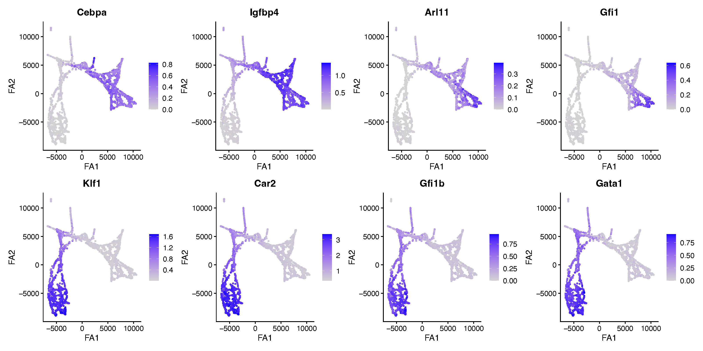
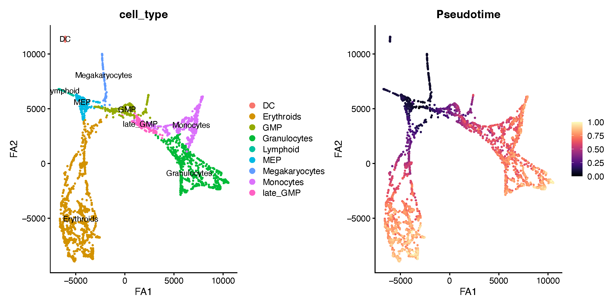
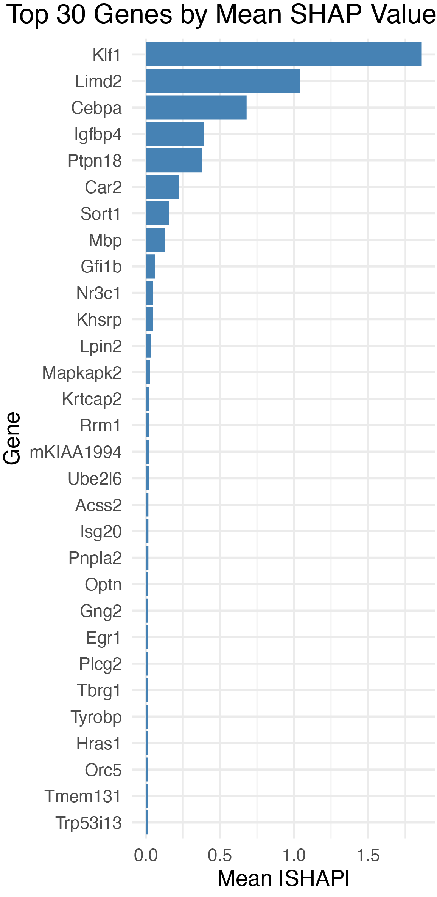
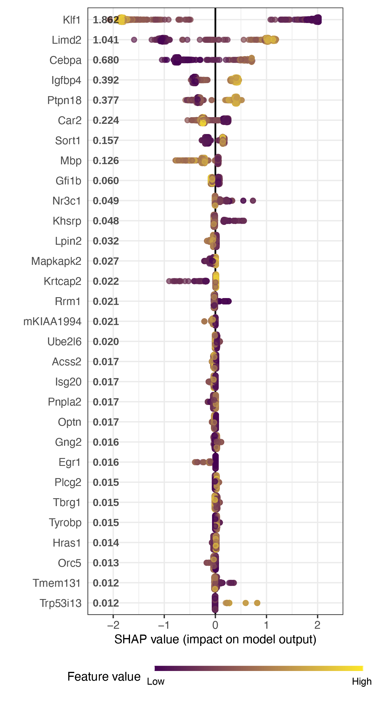

```{r setup, include=FALSE}
knitr::opts_chunk$set(
  echo = TRUE,
  eval = FALSE,
  warning = FALSE,
  message = FALSE
)
```

In this tutorial, we demonstrate how to identify the genes that best
separate two groups of cells using **SHAP (SHapley Additive
exPlanations)** values. We refer to these genes as **key driver genes**.
Rather than testing each gene independently as in differential
expression, `compact` trains a gradient-boosted decision tree
classifier (XGBoost) to distinguish two groups of cells based on their
gene expression, and then uses SHAP to measure how much each gene
contributes to that classification. This gives a ranking of genes by
their importance in a single multivariate model that considers all
genes jointly.

For this tutorial we use the mouse hematopoiesis dataset from [Kamimoto
et al. 2023](https://www.nature.com/articles/s41586-022-05688-9) (the
CellOracle study), where cells differentiate along two branches: the
**granulocyte-monocyte (GM) lineage** and the **megakaryocyte-erythroid
(ME) lineage**. Our goal is to find the genes that most strongly
distinguish cells committing to the GM lineage from those committing to
the ME lineage.

## What is SHAP?[](#what-is-shap)

To identify genes that contribute to distinguishing cellular states,
`compact` trains an XGBoost (extreme gradient boosting) classifier using
gene expression values from the Seurat object, and then computes **SHAP
(SHapley Additive exPlanations)** values to quantify the contribution of
each gene to the model's predictions. SHAP values are grounded in
cooperative game theory: each gene is assigned a feature-attribution
score that accounts for both its independent effect and its interactions
with other genes. For each cell or nucleus, a local SHAP value is
computed for every input gene using the `SHAPforxgboost` framework.

Global gene importance is defined as the mean absolute SHAP value across
all cells:

$$I_j = \frac{1}{n} \sum_{i=1}^{n} \left| \phi_j^{(i)} \right|$$

where $\phi_j^{(i)}$ is the SHAP value for gene $j$ in cell $i$ (the
superscript is a cell index, not an exponent) and $n$ is the total
number of cells. Genes are ranked by $I_j$, and the top-ranked genes are
prioritized as candidate key drivers of the transcriptional state or
perturbation response being compared.

<details class="alert alert-info">
<summary><strong>Interpretation</strong> — what SHAP-prioritized drivers mean</summary>

SHAP-prioritized drivers are genes whose expression patterns are most
*predictive* of the specified state or condition in the trained model.
They may represent upstream regulators, downstream transcriptional
consequences, or correlated markers, and should therefore be interpreted
as candidate predictive drivers rather than direct causal regulators.

</details>

## Load the dataset[](#load-the-dataset)

First we load the single-cell dataset and the required R libraries for
this tutorial. This dataset has already been processed with hdWGCNA to
construct a transcription-factor co-expression network, and expression
values have been imputed and stored in the `imputed` assay.

```{r eval=FALSE}
# single-cell analysis package
library(Seurat)

# plotting and data science packages
library(tidyverse)
library(cowplot)
library(patchwork)
library(viridis)

# co-expression network analysis package
library(hdWGCNA)

# compact
library(compact)

# machine learning backend used by the SHAP analysis
library(xgboost)

# using the cowplot theme for ggplot
theme_set(theme_cowplot())

# set random seed for reproducibility
set.seed(12345)

# load the dataset
seurat_obj <- readRDS('celloracle_tf_net.rds')

seurat_obj
```

```
An object of class Seurat
6902 features across 2730 samples within 2 assays
Active assay: RNA (3451 features, 0 variable features)
 2 layers present: counts, data
 1 other assay present: imputed
 3 dimensional reductions calculated: pca, draw_graph_fa, diffmap
```

The object contains two assays: the raw `RNA` assay and an `imputed`
assay. We will use the imputed expression values for the SHAP analysis,
since smoothed values give the classifier a cleaner signal in sparse
single-cell data.

## Visualizing the two lineages (optional)[](#visualizing-the-two-lineages)

Before running the key driver analysis, it is helpful to confirm that
the two lineages are separated in the data and to inspect a few
canonical marker genes. Here we plot known GM-lineage markers (`Cebpa`,
`Igfbp4`, `Arl11`, `Gfi1`) and ME-lineage markers (`Klf1`, `Car2`,
`Gfi1b`, `Gata1`) on the ForceAtlas2 (`draw_graph_fa`) embedding, using
the imputed assay.

```{r eval=FALSE}
# set imputed as the active assay for plotting marker expression
DefaultAssay(seurat_obj) <- "imputed"

# GM-lineage markers
gm_markers <- c("Cebpa", "Igfbp4", "Arl11", "Gfi1")

# ME-lineage markers
me_markers <- c("Klf1", "Car2", "Gfi1b", "Gata1")

# helper to make a consistent FeaturePlot for each gene
plot_marker <- function(gene){
  FeaturePlot(
    seurat_obj,
    features = gene,
    reduction = "draw_graph_fa",
    pt.size = 0.5
  ) + labs(x = "FA1", y = "FA2")
}

# GM markers on top row, ME markers on bottom row
gm_plots <- wrap_plots(lapply(gm_markers, plot_marker), nrow = 1)
me_plots <- wrap_plots(lapply(me_markers, plot_marker), nrow = 1)

gm_plots / me_plots
```



The GM markers (top row) and ME markers (bottom row) light up in
opposite regions of the embedding, confirming that the two lineages
occupy distinct branches.

We can also visualize the cell type annotations and the pseudotime
ordering to see the overall structure of the differentiation
trajectory.

```{r eval=FALSE}
# plot cell type annotations
DefaultAssay(seurat_obj) <- "RNA"
p1 <- DimPlot(
  seurat_obj,
  reduction = "draw_graph_fa",
  group.by = "cell_type",
  pt.size = 0.5,
  label = TRUE
) + labs(x = "FA1", y = "FA2")

# plot pseudotime
seurat_obj$Pseudotime <- as.numeric(seurat_obj$Pseudotime)
p2 <- FeaturePlot(
  seurat_obj,
  features = "Pseudotime",
  reduction = "draw_graph_fa",
  pt.size = 0.5,
  order = TRUE
) +
  scale_color_viridis(option = "magma") +
  labs(x = "FA1", y = "FA2")

p1 | p2
```



## Define the groups for comparison[](#define-the-groups-for-comparison)

The SHAP key driver analysis compares two groups of cells, specified by
a column in the Seurat object's metadata. Here we create a single
`Lineage` column that labels each cell as `Lineage_GM`, `Lineage_ME`, or
`False` (cells that belong to neither lineage).

```{r eval=FALSE}
obj <- seurat_obj

# start with all cells unassigned
obj$Lineage <- "False"

# label cells belonging to each lineage
obj$Lineage[obj$Lineage_ME %in% "True"] <- "Lineage_ME"
obj$Lineage[obj$Lineage_GM %in% "True"] <- "Lineage_GM"

table(obj$Lineage)
```

```
     False Lineage_GM Lineage_ME
       139       1315       1276
```

<details class="alert alert-info">
<summary><strong>Tip:</strong> how the <code>False</code> cells are handled</summary>

`FindShapKeyDriver` only uses the cells in `ident.1` and `ident.2`, so the
`False` cells are automatically ignored in the comparison below. If you
prefer, you can `subset()` the object to the two lineages first.

</details>

## Identify SHAP key driver genes[](#identify-shap-key-driver-genes)

Now we run `FindShapKeyDriver` to train the classifier and compute SHAP
values. `FindShapKeyDriver` reads expression from the **default assay**,
so we first set the active assay to `imputed`; by default it uses the
`data` layer of that assay (controlled by the `expr_layer` argument). The
`conditions` argument names the metadata column that defines the groups.
Here we run a **pairwise** comparison by supplying `ident.1` and
`ident.2`; `ident.1` is treated as the positive class. (For a
one-versus-rest comparison, supply `set_case` instead of the two
`ident` arguments.) We pass all genes in the object as candidate features
via `variable_genes`, and `out_dir` specifies where results are written.

```{r eval=FALSE}
# use imputed expression values as features
DefaultAssay(obj) <- "imputed"

obj <- FindShapKeyDriver(
  obj,
  conditions = "Lineage",
  ident.1 = "Lineage_GM",
  ident.2 = "Lineage_ME",
  variable_genes = rownames(seurat_obj),
  out_dir = "Lineage_GM_vs_Lineage_ME/"
)
```

The SHAP results are stored on the returned object in
`obj@misc$shap` — this is where the plotting functions below look for
them, so be sure to assign the output back to `obj`. The slot includes
`shap_summary` (mean absolute SHAP per gene, sorted), `key_drivers` (the
top-ranked genes), and `shap_long` (per-cell, per-gene SHAP values). If
`out_dir` is set, the same results are also written to disk under a
`shap_output_<mode>/` subfolder (here, `Lineage_GM_vs_Lineage_ME/shap_output_full/`),
which can be reloaded later with `ReloadShapOutput()`.

By default `FindShapKeyDriver` runs in `mode = "full"`, training on all
cells. You can instead set `mode = "split"` for a train/test split or
`mode = "cv"` for k-fold cross-validation; in those two modes a held-out
AUC is reported (when the `pROC` package is installed) as a measure of
how separable the two groups are. Note that the cells over which SHAP
values are computed depend on the mode: all cells in `"full"`, the
held-out test cells in `"split"`, and the pooled held-out folds in
`"cv"`.

Ranking is by mean absolute SHAP value, so the `shap_summary` table is
always non-negative — the *direction* of each gene's effect (toward the
GM or the ME lineage) is read off the beeswarm plot below, where per-cell
SHAP values keep their sign. Because `ident.1` is the positive class,
positive SHAP values push a cell toward the GM lineage and negative
values toward the ME lineage.

## Visualize the SHAP results[](#visualize-the-shap-results)

Both plotting functions return a `ggplot` object, so you can save them
with `ggsave()` as shown below. Alternatively, each function can write
the figure for you if you set `save_plot = TRUE` together with `out_dir`
and `filename` — in that case PDFs are written with the cairo device, and
`BeeswarmplotShap` rasterizes the point layer, which keeps file sizes
manageable when plotting many cells.

### Bar plot of top driver genes[](#bar-plot-of-top-driver-genes)

`BarplotShap` ranks genes by their mean absolute SHAP value and shows
the top `top_n` genes. This is the quickest way to see which genes carry
the most weight in separating the two lineages.

```{r eval=FALSE}
p <- BarplotShap(obj, top_n = 30)

ggsave(
  "Lineage_GM_vs_Lineage_ME/barplot_top_shap_genes_Lineage_GM_vs_Lineage_ME.pdf",
  plot = p, width = 4, height = 8, dpi = 300
)

p
```

{width=50%}

### Beeswarm plot of SHAP values[](#beeswarm-plot-of-shap-values)

`BeeswarmplotShap` shows the full distribution of SHAP values for each
of the top genes. Each point is a single cell: its position on the
x-axis is the gene's SHAP value in that cell, and its color encodes the
gene's expression level (from `min_color` for low expression to
`max_color` for high expression). This reveals not just *which* genes
are important, but *how* they drive the classification — for example,
whether high expression of a gene pushes cells toward the GM or the ME
lineage.

```{r eval=FALSE}
p <- BeeswarmplotShap(
  obj,
  top_n = 30,
  min_color = "#440154",
  max_color = "#FDE725"
)

ggsave(
  "Lineage_GM_vs_Lineage_ME/beeswarm_top_shap_genes_Lineage_GM_vs_Lineage_ME.pdf",
  plot = p, width = 4, height = 8, dpi = 300
)

p
```

{width=50%}

In this plot, genes near the top are the strongest drivers. A gene whose
high-expression cells (yellow) sit on the positive side of the axis and
whose low-expression cells (purple) sit on the negative side is one that
is turned on specifically in one lineage and off in the other.

<details class="alert alert-warning">
<summary><strong>Troubleshooting:</strong> if <code>BeeswarmplotShap</code> errors with <code>object 'new_labels' not found</code></summary>

Define `new_labels <- NULL` in your global environment before calling the
function:

```r
new_labels <- NULL
```

This is a known scoping issue in an upstream dependency (`SHAPforxgboost`)
and the workaround can be removed once it is fixed upstream.

</details>

## Interpretation[](#interpretation)

The key driver analysis identifies genes whose expression the model
relies on to tell the two lineages apart. Because the ranking comes from
a multivariate classifier rather than gene-by-gene testing, the top
drivers tend to be the most informative markers of lineage commitment,
accounting for the redundancy among co-expressed genes. Driver genes
that are also transcription factors or hub genes of your co-expression
modules are especially worth following up, since they are strong
candidates for regulators of the lineage decision.
